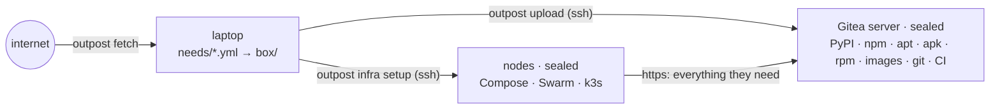
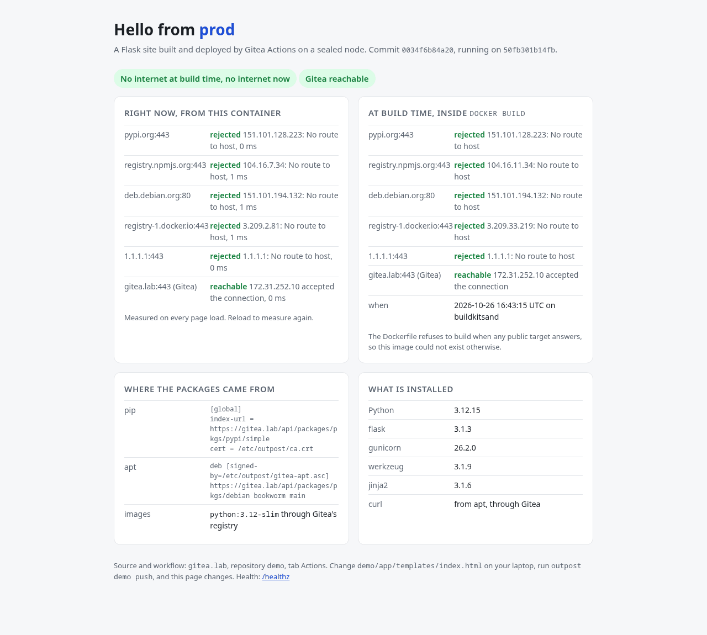
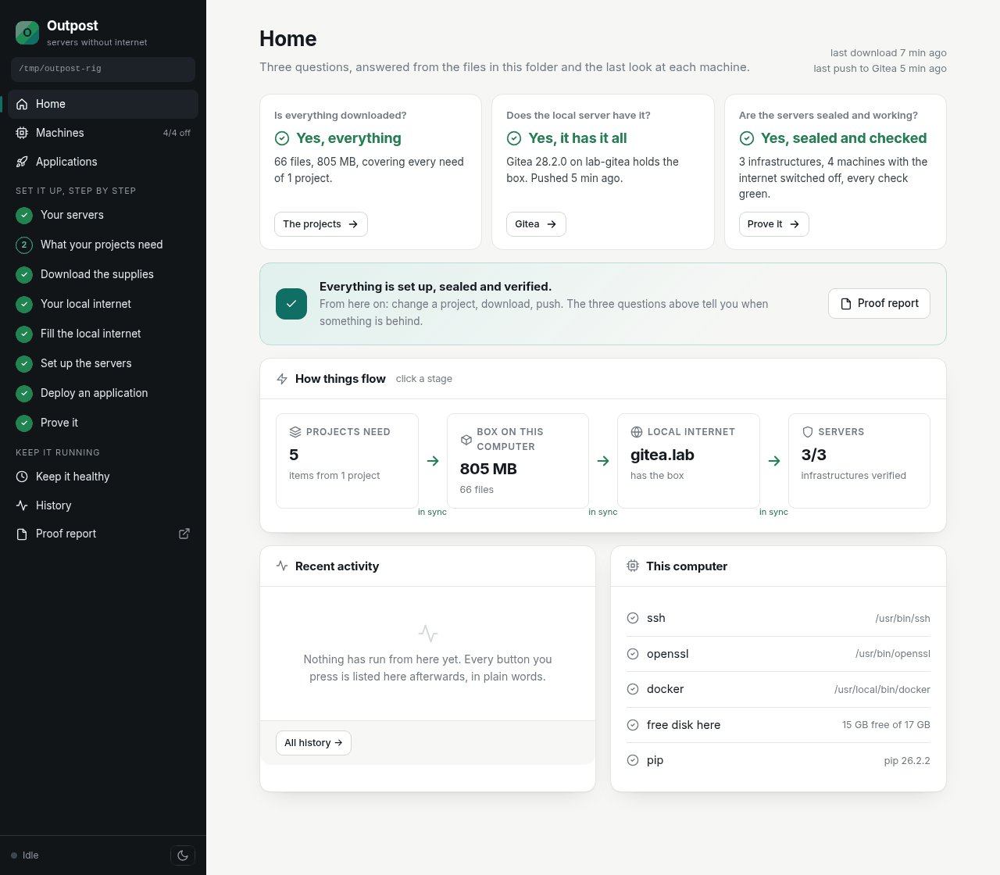
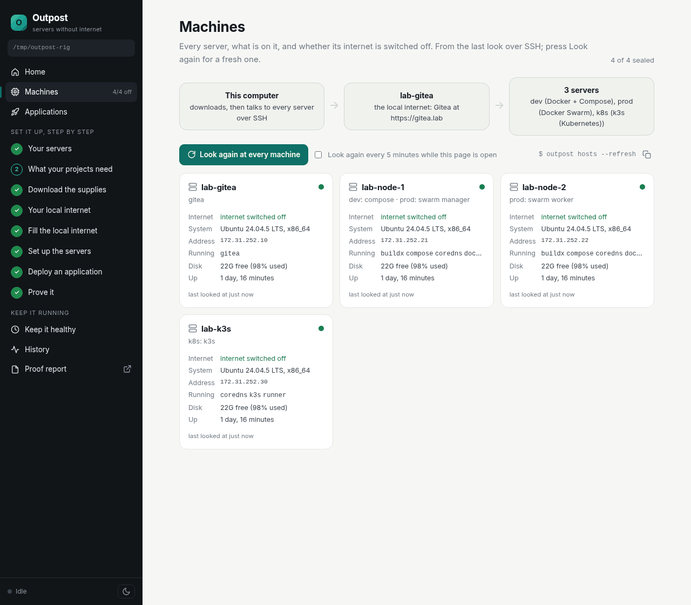
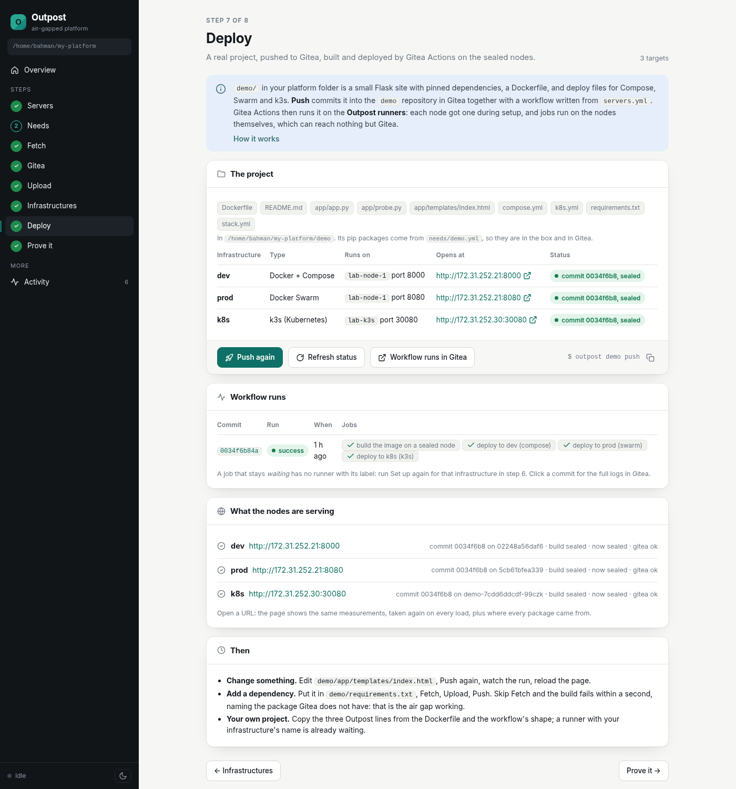

<h1 align="center">Outpost</h1>

<p align="center"><b>Run Gitea, Docker, Swarm or k3s on servers that never touch the internet.</b></p>

<p align="center">
  
  
  
  
  
</p>

Outpost is a small Python tool you run on your laptop. It reads your projects' lockfiles,
downloads everything they need while you have internet, pushes it into **one Gitea server**,
and configures your other servers to use only that Gitea. Builds and deployments then work
with the internet switched off, and every server **rejects** any attempt to reach outside, with
a firewall rule you can read and a verification table you can show.



<p align="center">
  
  <br><sub>The demo app, built and deployed by Gitea Actions on a sealed node. It probes the internet at build time and on every page load.</sub>
</p>

## Contents

- [Why](#why)
- [Highlights](#highlights)
- [Try it in twenty minutes](#try-it-in-twenty-minutes)
- [What you write](#what-you-write)
- [How it works](#how-it-works)
- [The dashboard](#the-dashboard)
- [What it proves](#what-it-proves)
- [Commands](#commands)
- [Compared with](#compared-with)
- [FAQ](#faq)
- [Documentation](#documentation)
- [Project layout and tests](#project-layout-and-tests)
- [Status and limits](#status-and-limits)

## Why

Public registries are a hidden dependency of every build. `pip install` talks to pypi.org,
`npm install` to npmjs.org, `apt-get` to deb.debian.org, `FROM python:3.12` to Docker Hub,
and nothing writes any of it down. When they are unreachable, blocked or compromised,
nothing ships, and nobody can say what the system actually needed.

An air-gapped setup is the strict answer, and the usual way there is heavy: a PyPI mirror, an
npm mirror, an apt mirror, a container registry, a git server and a CI system, each with its
own install, storage and upgrade path. Outpost's claim is that **one small tool and one
server are enough**, and that the result should be simple enough to understand in an
afternoon:

- Gitea is one static binary with built-in registries for PyPI, npm, Debian, container images
  and plain files, plus git hosting and CI. It replaces five services.
- The laptop needs Python and `ssh`. The servers need `ssh` and nothing else.
- The list of what a system needs becomes a file you can read, diff and review.
- The firewall turns "we think it is offline" into "here is the table that says so".

## Highlights

- **One command per step**, in the order you use them: `init`, `fetch`, `gitea setup`,
  `upload`, `infra setup`, `check`, `demo push`. Every step is idempotent and logged.
- **Lockfiles as input.** `uv.lock`, `poetry.lock`, `Pipfile.lock`, `requirements*.txt`,
  `package-lock.json`, `pnpm-lock.yaml`, `yarn.lock`, plus images, OS packages and files with a URL.
- **Three OS package families.** apt for Debian and Ubuntu, apk for Alpine, rpm for Rocky, Alma,
  Fedora and CentOS Stream, each resolved with the real package manager inside a container of the
  real distro, so the full dependency tree lands in Gitea's Debian, Alpine or RPM registry.
- **Three runtimes from one Gitea.** Docker Compose nodes, a Docker Swarm, or a k3s cluster,
  declared in a 15-line `servers.yml`. One node can serve several infrastructures.
- **A real seal.** iptables rejects outbound internet for the host *and* for its containers and
  pods, with a kernel-level backstop in the `security` table that stays effective whatever
  Docker or k3s add to the firewall. Open it on purpose with a logged reason.
- **Named exceptions, by name.** When an app must call `api.twilio.com` or an e-mail API behind a
  CDN, list the names under `egress_proxy` in `servers.yml`: one tinyproxy from Gitea, sealed with a
  single exception for its own user, lets through only those names (TLS stays end to end), logs
  every request, and workloads opt in with `HTTPS_PROXY`. A program that does not opt in is still
  sealed. See [named exceptions](docs/architecture/proxy.md).
- **Dockerfiles change by two lines.** `FROM` names the Gitea copy of the base image
  (`${GITEA}/pkgs/library--python:3.12-slim`), and `COPY --from=config / /` brings pip, npm, apt,
  apk, dnf and CA configuration into the build. Nothing on a node rewrites image names: a bare Docker Hub
  name fails at once, like every other reach for the internet.
- **CI that cannot cheat.** Gitea Actions runners on the nodes, in host mode: a job is a shell
  script on a sealed node, under the same rules as everything else.
- **A demo you can audit.** A Flask site whose Dockerfile refuses to build if the internet
  answers, deployed to Compose, Swarm and k3s by one workflow.
- **A dashboard for people who do not type commands.** Home answers three questions
  (downloaded? on the server? sealed and working?), Machines shows every server and what it
  runs, each step says what the button will do before you press it, progress is narrated,
  failures are translated into a sentence and a fix, and the history reads like a diary.
- **Day two is covered.** `gitea backup` and `restore` (and an automatic backup before a Gitea
  upgrade), `hosts` for versions and drift, `infra upgrade` for OS security updates served by
  Gitea, `pki rotate` for the CA, `report` for one HTML page of evidence.
- **A lab.** `outpost lab up` makes throwaway servers in Docker (systemd, sshd, real iptables),
  so the whole flow runs on one machine. The integration tests use the same lab.
- **No framework.** About 4,500 lines of Python, standard library plus PyYAML. Servers get
  shell scripts and static binaries you can read in `outpost/infra/`.

## Try it in twenty minutes

Needs Python 3.11+, `ssh`, `openssl` and Docker on your machine.

```
pipx install .                         # from a checkout; not on PyPI yet
outpost init my-platform && cd my-platform
outpost lab up                         # four "servers" in Docker; servers.yml written for them
outpost fetch                          # the demo's needs + Gitea, Docker, k3s, CoreDNS, the runner → box/
outpost gitea setup                    # Gitea on https://172.31.252.10, with a private CA, sealed
outpost upload                         # the box → Gitea's registries, plus the config image
outpost infra setup dev                # a Compose node: configured, sealed, Docker installed from Gitea, verified
outpost infra setup prod               # a two-node Swarm
outpost infra setup k8s                # a k3s server
outpost check --infra dev              # build and run on the sealed node; a container cannot reach pypi.org
outpost demo push                      # Gitea Actions builds the demo and deploys it to all three
```

Setup ends with a verification table for every node:

```
Verifying dev
  lab-node-1: all good
    ok   gitea in /etc/hosts
    ok   gitea reachable with trusted TLS
    ok   system trust store has the CA
    ok   pip points at gitea
    ok   npm points at gitea
    ok   package sources are gitea only
    ok   node dns for containers running
    ok   package index updates offline
    ok   egress sealed
    ok   public internet rejected
    ok   egress seal survives reboot
    ok   routed traffic sealed too (containers, pods)
    ok   docker running
    ok   compose plugin
    ok   buildx plugin
    ok   docker trusts and reaches gitea registry
    ok   container egress hooked
    ok   actions runner active
```

With an `egress_proxy` in `servers.yml`, every node's table has three more lines, and
`outpost proxy setup` prints the proxy host's own:

```
    ok   proxy settings for programs that opt in
    ok   proxy reachable               (example.org through the proxy -> 200)
    ok   proxy refuses unknown names   (CONNECT example.com -> 403)
```

Then open `http://172.31.252.21:8000` (Compose), `:8080` (Swarm) or `http://172.31.252.30:30080`
(k3s). The page says *No internet at build time, no internet now* and lists what it probed.
The pipeline is at `https://172.31.252.10/pkgs/demo/actions`.

With real servers, replace `lab up` by SSH aliases in `servers.yml`; nothing else changes.
The [tutorial](docs/tutorial/01-the-problem.md) walks through every step and what it does on
the servers.

## What you write

`servers.yml`, using aliases from `~/.ssh/config` (root, or a user with passwordless sudo):

```yaml
gitea:
  host: gitea-1
  name: gitea.internal          # any name; nodes learn it from /etc/hosts, no DNS needed
infrastructures:
  dev:  {type: compose, nodes: [dev-1]}
  prod: {type: swarm,   nodes: [prod-1, prod-2, prod-3]}
  k8s:  {type: k3s,     nodes: [k8s-1, k8s-2]}
```

`needs/my-api.yml`, pointing at lockfiles you already have:

```yaml
python: "3.12"
images: [python:3.12-slim, postgres:16]
pypi:  [{file: ../../my-api/uv.lock}]
npm:   [{file: ../../my-web/package-lock.json}]
apt:   {distro: bookworm, packages: [libpq-dev]}
apk:   {branch: v3.20, packages: [curl]}          # for an alpine:3.20 base
rpm:   {distro: rocky9, packages: [git]}          # for a rockylinux:9 base
files: [{url: https://github.com/jqlang/jq/releases/download/jq-1.7.1/jq-linux-amd64, name: jq, version: "1.7.1"}]
```

And two lines in each Dockerfile: the base image by its Gitea name, and the config image copied in:

```dockerfile
ARG GITEA
FROM ${GITEA}/pkgs/config:latest AS config
FROM ${GITEA}/pkgs/library--python:3.12-slim     # the Gitea copy of python:3.12-slim
COPY --from=config / /
# apt-get, pip and npm now use Gitea (apk add on an Alpine base, dnf install on a RHEL one). Nothing else changes.
```

## How it works

| step | on the laptop | on the servers |
|---|---|---|
| `fetch` | reads needs and lockfiles; pulls images with a small OCI client, wheels with `pip download` for the server's platform, OS packages with apt, apk or dnf inside a container of the right distro; writes `box/manifest.json` | nothing |
| `gitea setup` | creates a private CA and a server certificate with `openssl` | copies the Gitea binary from the box over `scp`; writes `app.ini` (HTTPS 443, SQLite, registries and Actions on); creates the admin user, token and organisation; seals the host |
| `upload` | verifies the box against its manifest; opens an SSH tunnel to port 443 | receives every file into the matching registry (409 for files it has); the `config` image is built on the laptop and pushed |
| `infra setup` | | writes `/etc/hosts`, the CA, `pip.conf`, `npmrc`, an apt, apk or dnf source (by the node's family), `daemon.json` or `registries.yaml`; **seals**; then downloads CoreDNS, Docker or k3s and the Actions runner **from Gitea**; verifies |
| `check`, `demo push` | runs smoke checks over SSH; commits the demo through Gitea's API | the runner builds the image on the node; the deploy jobs run `compose up`, `stack deploy` or `kubectl apply` and wait until the node serves the new commit |

Five ideas carry the design:

1. **Gitea is the local internet.** Every client speaks its native protocol to Gitea, and
   everything lives under one organisation: wheels, tarballs, packages, files, and images as
   `pkgs/<owner>--<image>` (`library--python`, `bitnami--redis`, `org--app` for `ghcr.io/org/app`).
   Dockerfiles and manifests name that copy explicitly; nothing on a node rewrites names.
2. **The box is a folder.** A manifest with a SHA-256 per file, optionally packed into signed
   `tar.xz` files for USB sticks or GitHub releases.
3. **Seal first, install after.** Docker, k3s, CoreDNS and the runner are fetched from Gitea
   with the internet already blocked. Setup finishing is itself the proof the box was complete.
4. **Reject, and reject below the clients.** One iptables chain in the `filter` table
   (REJECT, so failures are instant and name the host) and again in the `security` table
   (DROP, evaluated last, so no runtime's rules can get ahead of it).
5. **A config image and a node DNS.** The same generated files go to every host and into
   `pkgs/config:latest`; CoreDNS on each node answers the Gitea name for containers, because
   pip refuses HTTPS to a bare IP and containers cannot see `/etc/hosts`.

The [architecture pages](docs/architecture/overview.md) have the long version, and
[decisions](docs/development/decisions.md) records what we tried on the way, including the
hole where k3s pods could reach the internet while the host could not, and how it was closed.

## The dashboard

`outpost ui` opens a local page over the same platform folder. It only edits files and runs
CLI commands, and prints the command behind every button, so it doubles as a tutorial. It is
written for someone who has never opened a terminal: pages are named for what they are about,
every action says what it will do, which machines it touches and how long it takes, a running
command shows its steps, and a failed one is explained in a sentence with what to do.

<p align="center">
  
  <br><sub>Home: is everything downloaded, does the local server have it, are the servers sealed and working.</sub>
</p>
<p align="center">
  
  <br><sub>Machines: every server, its internet switched off, what runs on it, when it was last looked at.</sub>
</p>
<p align="center">
  
  <br><sub>Deploy: one workflow, three infrastructures, every node serving the pushed commit, sealed at build time and now.</sub>
</p>

## What it proves

| claim | enforced by | checked by |
|---|---|---|
| a node builds and runs with the internet off | every client points at Gitea; the box held what the build needed | `outpost check`; the demo's build-time probe |
| a node cannot reach the public internet | iptables REJECT on `OUTPUT` and `FORWARD`, DROP backstop in `security` | `verify`; the demo page's live probe |
| containers and pods are sealed too | the same chains on routed traffic | `hello-python` and `hello-k3s` checks |
| the seal survives a reboot | a oneshot unit before Docker and k3s | `verify` |
| every exception is written down and every opening is logged | `allow:` in `servers.yml`; `/var/log/outpost-egress.log` | `iptables -S OUTPOST`; the node page |
| a named exception reaches only its names, and only for programs that ask | the egress proxy's allow list; one owner match for its user on TCP 443 and 80, on its host only | `outpost proxy verify`; `proxy refuses unknown names` on every node; `hello-proxy` checks; `/var/log/outpost-proxy.log` |

Not covered: root on a node can remove the rule (and it will be logged); Gitea is a single
server with no HA; content is mirrored as the lockfiles say, not vetted; inbound ports are
your provider's firewall; with an egress proxy, an allowed name is allowed for any workload that
opts in, and DNS (port 53) stays open to any resolver. [The full list](docs/architecture/security.md).

## Commands

| command | does |
|---|---|
| `outpost init [folder]` | create a platform folder: `servers.yml`, `needs/`, `checks/`, `demo/` |
| `outpost needs` | print the merged needs, with the pinned platform files |
| `outpost fetch [--only kinds]` | download into `box/`; incremental |
| `outpost pack [--out dist]` | signed `tar.xz` per kind, for releases or USB |
| `outpost gitea setup` / `info` | install or upgrade Gitea (backup first); show its address and seal |
| `outpost gitea backup` / `restore <archive>` | archive Gitea's data to `backups/`; put it back |
| `outpost upload [source ...]` | box folder or archives → Gitea |
| `outpost infra setup <name>` / `verify <name>` / `upgrade <name>` / `list` | configure, seal, install, verify; OS updates from Gitea |
| `outpost check [name] --infra <name>` | smoke checks on the sealed node |
| `outpost demo push` / `status` | deploy the demo through Gitea Actions; see the runs and what nodes serve |
| `outpost egress <target> seal\|open\|status [--reason]` | flip the seal on Gitea, an infrastructure or one host |
| `outpost proxy setup` / `verify` | the egress proxy for `egress_proxy` in `servers.yml`: install, seal, update the nodes, verify |
| `outpost ui [--port 8484]` | the dashboard |
| `outpost lab up [--small]` / `down` | throwaway servers in Docker |
| `outpost hosts [--refresh]` | what every server runs: versions, seal, workloads, drift |
| `outpost pki rotate` | new CA and certificate, pushed to Gitea, the config image and every node |
| `outpost report [--out file]` | the proof report as one HTML page |

`--dir <folder>` selects another platform folder. [Full reference](docs/reference/cli.md),
[day-two commands](docs/reference/maintenance.md).

## Compared with

| | Outpost | a stack of mirrors (devpi, Verdaccio, aptly, registry, git, CI) | Nexus / Artifactory |
|---|---|---|---|
| services to run | one (Gitea) | five or six | one, large |
| install | a Python tool over SSH; servers need nothing | each by hand or with configuration management | a JVM application, a database, storage planning |
| what is mirrored | exactly what the lockfiles list, written down in `needs/` | usually proxy caches: whatever was requested once | proxy or hosted repositories |
| proof of isolation | iptables seal on every server, `verify` table, probes inside builds | not included | not included |
| CI inside the gap | Gitea Actions runners on the nodes | separate | separate |
| scope | small teams and labs that want to understand every piece | flexible | enterprise |

Outpost is not a replacement for a large artifact server with fine-grained access control,
replication and retention policies. It is for the case where you want the whole thing to fit
in your head.

## FAQ

**Does the laptop need to be inside the sealed network?** No. It needs SSH to the servers.
Gitea's API is reached through an SSH tunnel, so wherever `ssh gitea-1` works, everything works.

**Can I use my own Gitea?** Not yet. Outpost installs and configures Gitea with its own
`app.ini` and certificate so that every later step can assume the layout.

**What about images from ghcr.io or quay.io?** Fetched, uploaded and referenced like any
other: `ghcr.io/org/app:1.4` becomes `gitea.internal/pkgs/org--app:1.4`, exactly as
`python:3.12-slim` becomes `gitea.internal/pkgs/library--python:3.12-slim`. Docker Hub is not a
special case; a bare `FROM python:3.12-slim` on a sealed node fails at once, on purpose.

**Security updates for the OS?** Not mirrored unless you list the packages. Open egress for a
window with a reason, run the upgrade, seal. The log keeps the record.

**ARM servers?** Not yet; wheels, images and binaries are fetched for x86_64.

**Why not DROP everything instead of REJECT?** Because a rejected connection fails in
milliseconds with the name of the host, which turns the firewall into a to-do list. The
`security` table backstop does drop, as the kernel allows nothing else there.

**Is the box reproducible?** The box is what the lockfiles resolve to at fetch time. Pin
versions in lockfiles and the box is the same each time; the manifest lets you compare two.

## Documentation

| | |
|---|---|
| [Quickstart](docs/quickstart.md) | the whole flow on one page |
| [Tutorial](docs/tutorial/01-the-problem.md) | ten chapters: from the idea to a deployed app, on a lab or on real servers, with what happens on each server |
| [Architecture](docs/architecture/overview.md) | [the box](docs/architecture/box.md), [Gitea](docs/architecture/gitea.md), [what a node runs](docs/architecture/nodes.md), [the seal](docs/architecture/egress.md), [CI](docs/architecture/ci.md), [what it proves](docs/architecture/security.md) |
| [Reference](docs/reference/cli.md) | [commands](docs/reference/cli.md), [servers.yml](docs/reference/servers.md), [needs](docs/reference/needs.md), [Dockerfiles](docs/reference/dockerfiles.md), [checks](docs/reference/checks.md), [the platform folder](docs/reference/platform-folder.md), [the dashboard](docs/reference/dashboard.md), [day two: backup, updates, rotation, evidence](docs/reference/maintenance.md), [mirrors and releases](docs/reference/distribution.md), [limits](docs/reference/limits.md) |
| [Development](docs/development/development.md) | layout, [testing](docs/development/testing.md), [decisions and lessons](docs/development/decisions.md) |

The docs are Markdown with Mermaid diagrams and render on GitHub as they are. `mkdocs.yml`
publishes them as a site: `uvx --with mkdocs-material mkdocs serve`.

## Project layout and tests

```
outpost/
  cli.py          the commands, in the order you use them
  needs/ fetch/   lockfile parsers; one fetcher per kind (images, pypi, npm, apt, apk, rpm, files)
  box.py oci.py   manifest, pack, sign; pull and push images over HTTP
  ssh.py http.py  Host.run / write / put, the Tunnel; urllib with a private CA
  pki.py          CA, server certificate, box signing, with the openssl CLI
  gitea/          client (API + registries), setup over SSH, upload, connect (tunnel)
  infra/          clients (config files), common steps, egress, compose, swarm, k3s, runner, verify
  checks/ demo.py smoke checks; the demo project's workflow, push and status
  hosts.py        one SSH round trip per server: versions, seal, workloads, cached in state/hosts/
  report.py       the proof report, one HTML page from state/
  ui/             the dashboard: server.py, status.py, explain.py (errors into sentences), projects.py, index.html
  lab.py          throwaway servers in Docker
  templates/      what `outpost init` copies, and the lab server's Dockerfile
tests/            134 unit tests with a fake SSH host and a fake Gitea speaking real HTTP
tests/integration real Gitea container and Docker Hub; the full flow on the lab (fetch, a Gitea upgrade,
                  backup and restore, compose, swarm, k3s, the demo, a reboot, the dashboard's server side)
```

```
pytest                                              # ~10 s, no network
OUTPOST_INTEGRATION=1 pytest tests/integration      # a few minutes; needs Docker and the internet
```

## Status and limits

Version 0.1.0. Tested end to end: the integration suite installs the previous Gitea on a
throwaway systemd container over SSH, upgrades it to the pinned one with a backup first,
backs up and restores, uploads a real box, sets up and seals a Compose node, a two-node Swarm
and a k3s server, builds images on them with apt and pip served by Gitea and the internet
rejected, deploys the demo to all three through Gitea Actions, restarts the servers and checks
that the seal and the applications come back.

Pinned: Gitea 28.2.0, Docker 29.9.2, Compose 5.6.1, buildx 0.38.1, CoreDNS 1.15.0,
k3s v1.37.1+k3s1, Gitea runner 5.2.2. Ubuntu and Debian hosts; amd64 tested, arm64 wired
through but not yet run on ARM servers. One Gitea, no HA; backups are a command. Containers
stand in for servers in the tests, so a run on real virtual machines is the remaining step
before a 1.0. [Limits](docs/reference/limits.md) lists what Outpost does not do, on purpose
or not yet.

Contributions welcome: the [development page](docs/development/development.md) explains the
layout and the principles (files are the state; one module, one or two functions; no new
dependency without a reason). MIT licensed.
