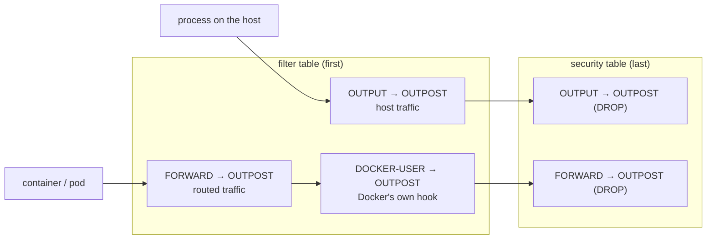

# The seal

The seal is what turns "configured to use Gitea" into "cannot use anything else". It is one
shell script, `/usr/local/sbin/outpost-egress`, generated by `outpost/infra/egress.py`,
installed on the Gitea server and on every node, with a systemd unit that re-applies it at boot.

```
outpost-egress seal [reason]     build the chains and hook them
outpost-egress open [reason]     unhook them (the chains stay, inert)
outpost-egress status            sealed | open
```

Every call appends a line to `/var/log/outpost-egress.log` with the time, the user and the reason.

## What is allowed

The chain `OUTPOST` returns (lets through) in this order and rejects everything else:

1. loopback
2. replies to established connections (so inbound SSH, HTTP and Swarm/k3s sessions work)
3. DNS, UDP and TCP port 53
4. the Gitea IP
5. the private ranges `10.0.0.0/8`, `172.16.0.0/12`, `192.168.0.0/16`
6. the `allow` list from `servers.yml`, plus the other nodes of the same infrastructure

IPv6 gets a chain of its own that allows loopback, replies and link-local, and rejects the
rest; Gitea is reached over IPv4.

## Where it is hooked, and why twice



**In the `filter` table** the chain ends in `REJECT --reject-with icmp-admin-prohibited` and is
inserted at position 1 of `OUTPUT`, `FORWARD` and `DOCKER-USER`. A rejected connection fails
immediately with "connection refused" or "network unreachable", so a build that reaches for
the internet dies within a second and names the host. That is the behaviour you want 99 % of
the time.

**In the `security` table** the same chain is built again, ending in `DROP`, and hooked into
`OUTPUT` and `FORWARD`. The kernel evaluates `security` after `filter`, and an `ACCEPT` in
`filter` does not skip it. This copy is the backstop, and it exists because of something we
learned the hard way:

> Docker, kube-proxy, kube-router and flannel all insert their rules at the **top** of `filter
> FORWARD` when they start, and on a fresh node they start *after* the seal. kube-router's rule
> "ACCEPT traffic that complies with network policies" accepts every pod's traffic when no
> policy exists, and it sat above our hook. Pods could reach the internet; the host could not.
> Re-sealing after k3s was running put our rule back on top, which is why the first test
> passed, but a reboot (where the egress unit runs before k3s) would have reopened it.

Nothing else writes to the `security` table, and being evaluated last means the order inside
`filter` no longer matters. `REJECT` is only permitted in `filter`, so the backstop drops; in
practice the host and Docker containers still get the instant rejection from `filter`, and a
k3s pod gets a timeout. Both are sealed, and verify checks both hooks:

```
ok   routed traffic sealed too (containers, pods)     iptables -C FORWARD -j OUTPOST && iptables -t security -C FORWARD -j OUTPOST
```

## Boot

`outpost-egress.service` is a oneshot unit, `Before=docker.service k3s.service`, that runs
`seal boot`. The seal is therefore in place before any container runtime starts, and thanks to
the `security` table it stays effective whatever those runtimes add to `filter` afterwards.
Verify's "egress seal survives reboot" checks that the unit is enabled.

## Testing it yourself

```
ssh -F lab/ssh_config lab-node-1
iptables -S OUTPOST; iptables -t security -S OUTPOST
curl -sS --max-time 3 https://pypi.org                      # host: rejected at once
docker run --rm alpine:3.20 wget -T 3 -O- https://pypi.org  # container: rejected at once
ssh -F lab/ssh_config lab-k3s
k3s kubectl run t --rm -it --image=alpine:3.20 --restart=Never -- wget -T 5 -O- https://pypi.org   # pod: times out
```

The `hello-k3s` check runs that last command for you and expects it to fail. The lesson that
went into `docs/development/decisions.md`: every runtime needs its own in-container egress
test; host-level checks say nothing about what the runtime's networking does.

## What the seal does not do

It does not touch inbound traffic: open or close ports with your provider's firewall. It does
not inspect content: a private address in the allow list is reachable for anything. It does
not stop a process with `CAP_NET_ADMIN` on the host from removing it, which is to say, root on
a node can open the internet, and the log will show it.

It does not match names. When an application must reach a third-party service by name, that goes
through the egress proxy, whose host alone gets one exception in this script (user
`outpost-proxy`, TCP 443 and 80, in a chain `OUTPOST-OUT` hooked from `OUTPUT` only): see
[named exceptions](proxy.md). Every other host's script is the one described here.
