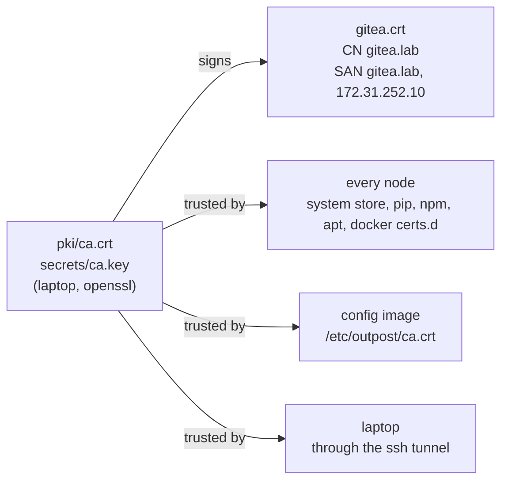

# Gitea as the local internet

Gitea is a git forge, like a self-hosted GitHub. Three of its features make it enough on its own:

1. **Package registries.** Gitea serves PyPI, npm, Debian, container (OCI) and generic
   registries, each with the protocol the normal client speaks. `pip`, `npm`, `apt`, `docker`
   and `curl` do not know they are talking to Gitea.
2. **Git hosting with HTTPS and SSH.** Your code lives next to its dependencies.
3. **Actions.** A GitHub-Actions-compatible CI with external runners, which Outpost installs on
   the nodes.

## How it is installed

See [the tutorial chapter](../tutorial/05-gitea.md) for the step-by-step. What ends up on the server:

| path | what |
|---|---|
| `/usr/local/bin/gitea` | the static binary, version pinned in `outpost/versions.py`, copied from the box |
| `/etc/gitea/app.ini` | written once; HTTPS 443, SQLite, packages and Actions on, registration off, `OFFLINE_MODE`, SSH on 2222 |
| `/etc/gitea/gitea.crt`, `gitea.key` | server certificate signed by your CA, valid for the name and the IP |
| `/var/lib/gitea/` | database, repositories, packages, logs; the only directory to back up |
| `/etc/systemd/system/gitea.service` | runs as user `git` with `CAP_NET_BIND_SERVICE` only |
| `/usr/local/sbin/outpost-egress` | the seal, applied last |

On the laptop: `pki/ca.crt` and `pki/gitea.crt` (public), `secrets/ca.key`, `secrets/gitea.key`,
`secrets/gitea-admin-password`, `secrets/gitea-token` (private), `state/gitea.json`.

## Certificates

A private CA means every client can verify Gitea the normal way, with no `--trusted-host`,
`NODE_TLS_REJECT_UNAUTHORIZED` or `insecure-registries` anywhere. pip in particular refuses
to speak HTTPS to a bare IP address, which is why Gitea has a name and every node runs a
small DNS server for its containers ([nodes](nodes.md)).

## The registries and their URLs

With the organisation `pkgs` and the name `gitea.lab`:

| client | configured with | URL |
|---|---|---|
| pip | `/etc/pip.conf` `index-url` | `https://gitea.lab/api/packages/pkgs/pypi/simple` |
| npm | `/etc/npmrc` `registry` | `https://gitea.lab/api/packages/pkgs/npm/` |
| apt | `sources.list.d/outpost.list` | `deb [signed-by=/etc/outpost/gitea-apt.asc] https://gitea.lab/api/packages/pkgs/debian bookworm main` |
| docker | `certs.d/gitea.lab/ca.crt`; the image name itself | `gitea.lab/pkgs/<owner>--<image>:<tag>`, e.g. `gitea.lab/pkgs/library--python:3.12-slim` |
| k3s / containerd | `registries.yaml` with the CA for `gitea.lab`; the image name itself | the same `gitea.lab/pkgs/<owner>--<image>:<tag>` |
| curl, scripts | generic registry | `https://gitea.lab/api/packages/pkgs/generic/<name>/<version>/<file>` |

Container images are no exception to "everything under `pkgs`". Upload pushes each one as
`pkgs/<owner>--<image>`, where the owner is the original one and `library` for official Docker
Hub images: `python:3.12-slim` becomes `pkgs/library--python:3.12-slim`, `bitnami/redis:7` becomes
`pkgs/bitnami--redis:7`, `ghcr.io/org/app:1.4` becomes `pkgs/org--app:1.4`. The owner stays in
the name so that `library/redis` and `bitnami/redis` cannot collide. Dockerfiles, Compose,
stack and Kubernetes files reference that name explicitly; there is no registry mirror on the
nodes, so a bare Docker Hub name is rejected by the seal like any other reach for the internet.
Only one organisation exists in Gitea.

## Tokens

| token | made by | scope | used for |
|---|---|---|---|
| `secrets/gitea-token` | `gitea setup`, with the Gitea CLI | all | everything Outpost does through the API: uploads, repositories, runners |
| `secrets/gitea-package-token` | `demo push`, with the admin password | `write:package`, `read:repository` | the Actions secret `PACKAGE_TOKEN`, so a job can `docker push` into Gitea |
| automatic `GITEA_TOKEN` in jobs | Gitea, per job | the repository | fetching the source archive in workflows |
| runner registration token | `infra setup`, admin API | one registration | registering a runner |

Both stored tokens are checked against the server when used: if Gitea does not know them
(reinstalled server, recreated lab), new ones are made and the files replaced.

## Reaching the API from the laptop

`outpost/gitea/connect.py` opens an SSH tunnel to the Gitea host's port 443 and sends HTTPS
requests to `localhost:<port>` with `Host: gitea.lab` and the CA from `pki/`. Nothing on the
laptop needs to resolve or route to the Gitea name; wherever `ssh gitea-1` works, the API works.
The client (`outpost/gitea/client.py`) is a thin wrapper over `urllib`: one method per API call,
plus the registry uploads (`upload_pypi`, `upload_npm`, `upload_debian`, `upload_generic`,
`push_image`), each returning whether the file was uploaded or already existed.
