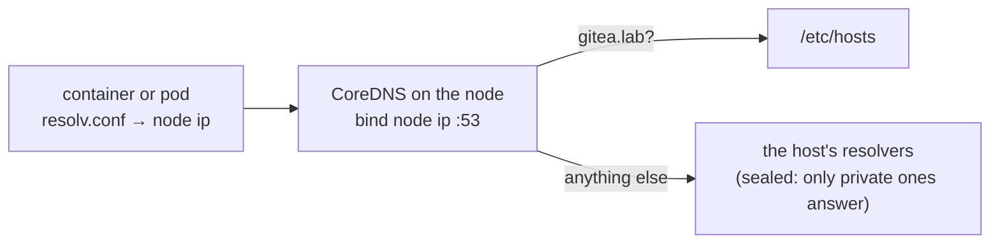

# What a node runs

A node is any server in an infrastructure. `outpost infra setup` gives every node the same
base, then adds the runtime for its type. Everything is a file or a systemd unit you can read
on the server; nothing is a daemon of Outpost's own.

## The base, on every node

| path | what | step |
|---|---|---|
| `/etc/hosts` | `172.31.252.10 gitea.lab`; `outpost-hosts.service` puts the line back at every boot (cloud-init and Docker rewrite the file) | 1 name |
| `/etc/outpost/ca.crt` | the CA; also in `/usr/local/share/ca-certificates/` (trust store) | 2 trust |
| `/etc/pip.conf` | `index-url` and `cert` → Gitea | 3 clients |
| `/etc/npmrc`, `/usr/local/etc/npmrc` | `registry` and `cafile` → Gitea | 3 |
| `/etc/apt/apt.conf.d/99outpost` | `Acquire::https::CaInfo` → the CA | 3 |
| `/etc/docker/daemon.json` | `dns: [<node ip>]`; no `registry-mirrors`, images are named by their Gitea copy | 3 |
| `/etc/docker/certs.d/gitea.lab/ca.crt` | the CA for Docker's registry client, so `gitea.lab/pkgs/...` pulls are trusted | 3 |
| `/etc/profile.d/outpost.sh` | `PIP_INDEX_URL`, `NPM_CONFIG_REGISTRY` and their CA variables for shells | 3 |
| `/etc/outpost/gitea-apt.asc` | Gitea's apt signing key | 4 apt |
| `/etc/apt/sources.list.d/outpost.list` | one `deb` line per distro Gitea serves | 4 |
| `/etc/apt/sources.disabled/` | where the stock sources were moved | 4 |
| `/usr/local/sbin/outpost-egress`, `outpost-egress.service` | the seal and its boot unit ([egress](egress.md)) | 5 seal |
| `/var/log/outpost-egress.log` | every seal and open, with who and why | 5 |
| `/usr/local/bin/coredns`, `/etc/outpost/Corefile`, `outpost-dns.service` | DNS for containers | 6 dns |
| `/etc/outpost/resolv.conf` | `nameserver <node ip>`, handed to k3s | 6 |
| `/usr/local/bin/gitea-runner`, `/etc/outpost/runner.yaml`, `/var/lib/outpost-runner/`, `outpost-runner.service` | the Actions runner, first node only ([ci](ci.md)) | 8 runner |

The config files are generated by one module, `outpost/infra/clients.py`, which is also what
builds the config image. A host and a build container therefore see exactly the same
configuration, and a change there changes both.

## DNS for containers



Containers do not see the host's `/etc/hosts`, and HTTPS needs a name that matches the
certificate, so each node runs CoreDNS with this Corefile:

```
.:53 {
    bind <node ip>
    hosts /etc/hosts { fallthrough }
    forward . /etc/resolv.conf
    cache 30
    reload
    errors
}
```

Docker hands the node's IP to every container and build through `daemon.json`; k3s starts with
`--resolv-conf /etc/outpost/resolv.conf`, so its own CoreDNS forwards to the node's. CoreDNS is
downloaded from Gitea after the seal, with the unit ordered before `docker.service` and `k3s.service`.

## Compose nodes

Docker's static binaries (`docker-<version>.tgz`) are extracted into `/usr/local/bin`, with a
systemd unit for `dockerd` ordered after `outpost-egress.service`. The Compose and buildx CLI
plugins go to `/usr/local/lib/docker/cli-plugins/`. Nodes of a Compose infrastructure do not
know about each other; each is a place to run `docker compose up`.

Extra checks: Docker running, Docker trusts and reaches Gitea's registry (`certs.d` has the CA and
`https://gitea.lab/v2/` answers), `DOCKER-USER` jumps to `OUTPOST`.

## Swarm

Docker as above on every node. The first node runs `docker swarm init --advertise-addr <ip>`
(plus `args:` from `servers.yml`); the others join as workers with the worker token. Each
node's IP is added to the others' allow lists so the overlay network (2377, 7946, 4789) is not
sealed. A service scheduled on any node pulls its image from Gitea by its Gitea name
(`gitea.lab/pkgs/library--alpine:3.20`); every node trusts the same CA.

Extra checks: swarm active, plus the Compose ones.

## k3s

| path | what |
|---|---|
| `/etc/rancher/k3s/registries.yaml` | `gitea.lab` endpoint `https://gitea.lab` with the CA; no `docker.io` entry |
| `/var/lib/rancher/k3s/agent/images/k3s-airgap-images-amd64.tar.gz` | every image k3s itself needs (pause, coredns, traefik, metrics-server, local-path), imported at start |
| `/usr/local/bin/k3s` | the binary; the official `install.sh` is run with `INSTALL_K3S_SKIP_DOWNLOAD=true` |
| `k3s.service` | `server --node-ip <ip> --resolv-conf /etc/outpost/resolv.conf <args>` |

The first node is the server; setup waits until the node is `Ready` and the default service
account exists. Further nodes are agents joined with `K3S_URL` and the server's node token.
Application images are pulled by containerd from Gitea by their Gitea name, so a manifest says
`image: gitea.lab/pkgs/library--alpine:3.20`; a bare `alpine:3.20` would ask Docker Hub and be
rejected by the seal. The lab passes `--kubelet-arg=eviction-hard=...` through `args:`
because the kubelet's default of "evict below 10 % free disk" is often true on a laptop.

Extra checks: k3s installed, `registries.yaml` points at Gitea, service active.

## Verification

`outpost infra verify` runs one shell command per check over SSH and reports `ok` or the
command's output. The list is in `outpost/infra/verify.py` (common) and in each type module
(`extra_checks`). It only reads; it never fixes. If a line is not `ok`, run setup again and
read its log.
