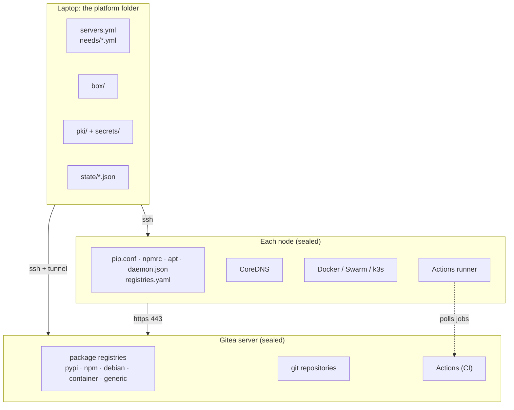

# Architecture overview

Outpost is about 4,500 lines of Python with one dependency, PyYAML. It is a control tool, not a
service: nothing of it runs on the servers. The servers get shell scripts, static binaries and
small config files, all of which you can read in `outpost/infra/` and `outpost/gitea/`.

## The pieces

| piece | lives in | job |
|---|---|---|
| CLI (`outpost/cli/`) | laptop | one file per command, in the order you use them |
| needs + fetch (`outpost/needs`, `outpost/fetch`) | laptop | lockfiles in, box out |
| box (`outpost/box.py`, `outpost/oci/`) | laptop | manifest, OCI layouts, pack, sign |
| ssh (`outpost/ssh/`) | laptop | `Host.run / write / put / get` and `Tunnel`; the only way servers are touched |
| Gitea client + setup + upload (`outpost/gitea`) | laptop | install over SSH, speak the registry APIs through the tunnel |
| infra (`outpost/infra`) | laptop, writes to nodes | common steps, egress, compose, swarm, k3s, runner, verify |
| checks, demo (`outpost/checks`, `outpost/demo.py`) | laptop | smoke tests and the demo pipeline |
| dashboard (`outpost/ui`) | laptop, localhost only | reads the platform folder, runs the CLI |
| lab (`outpost/lab.py`) | laptop | throwaway servers in Docker |

## The data flow

1. **Needs** are read from `needs/*.yml` and the lockfiles they point at, merged with the
   pinned platform files (Gitea, Docker, k3s, CoreDNS, the runner).
2. **Fetch** downloads into `box/` and writes `manifest.json`. The box is a plain folder and
   can be moved by any means.
3. **Gitea setup** installs Gitea over SSH from the binary in the box, issues certificates from
   the laptop's private CA, creates the admin user, token and organisation, then seals the host.
4. **Upload** verifies the box against its manifest and pushes each kind into the matching
   registry through an SSH tunnel, then builds and pushes the config image.
5. **Infra setup** prepares each node (name, trust, clients, apt, seal, DNS), installs the
   runtime and the runner from Gitea, records `state/infra-<name>.json`, and verifies.
6. **Check** and **demo** use the nodes as a team would: builds, deployments, a pipeline.

Every step is idempotent: run it again and it checks before acting. Every step leaves a small
JSON file in `state/`, which is how the dashboard knows what is in sync.

## Trust boundaries

- **The laptop is trusted.** It holds the CA key, the Gitea admin token and the box signing
  key, all under `secrets/`. Whoever controls the platform folder controls the platform.
- **Gitea is the only server nodes trust.** They trust it through a private CA you own, over
  HTTPS, by a name you chose. Nothing else is reachable, which is enforced below the clients,
  in the kernel's firewall, not by configuration the clients could ignore.
- **Nodes trust each other only as much as their runtime needs.** Swarm and k3s traffic is
  allowed between the nodes of one infrastructure; the allow list is explicit in the egress script.
- **The internet is not trusted and not reachable** from any server after setup. The laptop
  reaches it only during `fetch`, through whatever mirrors you configure.

## Why these choices

- **SSH only.** Every team already has SSH to its servers, and nothing else needs to be
  installed or kept running. Outpost's API access to Gitea is tunnelled over SSH for the same
  reason: it works wherever `ssh gitea-1` works.
- **Gitea for everything.** One binary, one SQLite file, five registries, git and CI. The
  alternatives (aptly, devpi, Verdaccio, Harbor, a git server, a CI server) each work, and
  together they are a project of their own.
- **Files as state.** The platform folder is readable, diffable and committable. There is no
  database, no daemon, no lock. The dashboard is a viewer and a button panel over the same files.
- **Lockfiles as the source of truth.** The versions your project tested with are already
  written down; Outpost reads them rather than inventing another list.
- **Reject, do not drop.** A sealed node answers a forbidden connection with an ICMP
  "administratively prohibited" at once, so failures are immediate and name the host.

The [decisions page](../development/decisions.md) records these and the ones we revised.
