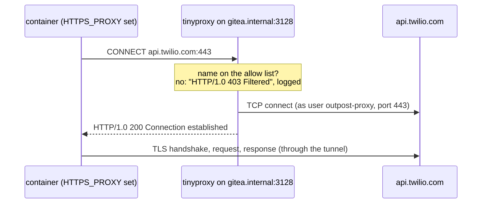

# Named exceptions: the egress proxy

Sometimes a sealed application must call a few services on the internet: an SMS API at
`api.twilio.com`, an e-mail provider behind a CDN. Outpost's answer is one outbound forward proxy,
installed and sealed like everything else, that lets through only the host names you list in
`servers.yml`. Programs opt in with the standard `HTTPS_PROXY` variable; a program that does not
still has no internet.

```yaml
egress_proxy:
  allow: [api.twilio.com, "*.sendgrid.net"]
  # host: gitea-1        # SSH alias; default: the Gitea host
  # port: 3128
  # distro: noble        # which tinyproxy to fetch; default: what `outpost hosts` learned about the host
```

```
outpost fetch --only apt     # adds tinyproxy for the proxy host's distro by itself
outpost upload
outpost proxy setup          # install, seal, bring already set-up nodes up to date, verify
outpost check hello-proxy --infra dev
```

## Why the seal cannot do this by itself

The seal ([egress](egress.md)) is address-based: an iptables rule matches IP addresses and ports,
never names. A rule for `api.twilio.com` would have to be written for the addresses that name has
today, and the addresses behind a CDN change from one DNS answer to the next and are shared with
thousands of other sites, so allowing them would allow those sites too. Keeping an ipset in step
with DNS answers (see [decisions](../development/decisions.md)) has the same problem and a race
besides.

A proxy can check the name, because the client tells it the name. That is the whole idea.

## How a request goes through



For HTTPS the client sends `CONNECT host:443`, the proxy checks `host` against its allow list,
opens a TCP connection and from then on copies bytes both ways. The TLS session is between the
client and the real server: the proxy sees the name and the amount of data, never the content, and
needs no certificate. The client still checks the server's certificate against its own trust store,
so a proxy that went wrong could not impersonate `api.twilio.com`. Plain HTTP requests
(`GET http://...`) are filtered the same way, by host name.

## What is installed, and where

The proxy is a host process under a systemd unit, by default on the Gitea host:

| path | what |
|---|---|
| tinyproxy | the distro's own package (`apt` on Debian and Ubuntu, `dnf` on the RHEL family), installed from Gitea like any other package; the distro's `tinyproxy.service` is masked |
| `/etc/tinyproxy/tinyproxy.conf` | the configuration below |
| `/usr/share/tinyproxy/outpost.allow` | one anchored extended regular expression per allowed name |
| `outpost-proxy.service` | `tinyproxy -d -c /etc/tinyproxy/tinyproxy.conf`, as the system user `outpost-proxy` |
| `/var/log/tinyproxy/tinyproxy.log` | every request line and every refusal; rotated weekly by `/etc/logrotate.d/tinyproxy` |
| `/usr/local/sbin/outpost-egress` | the seal, with the one exception below |

The paths are the package's own on purpose. tinyproxy may run under an AppArmor profile named
`tinyproxy` (Ubuntu 26.04 loads one; a host's kernel applies it inside privileged containers too)
that lets `/usr/bin/tinyproxy` read `/etc/tinyproxy/tinyproxy.conf` and `/usr/share/tinyproxy/*`
and write `/var/log/tinyproxy/tinyproxy.log` and `/run/tinyproxy/tinyproxy.pid`, and nothing else,
whatever the file permissions say. So Outpost's configuration replaces the package's, the allow list
sits next to the package's error pages, the log is the package's log, and Outpost's logrotate file
replaces the package's (which would reload the masked stock unit). Outpost adds no AppArmor rules,
and the same paths work on a host without a profile. tinyproxy opens its log after it has dropped to
`outpost-proxy`, and a package upgrade gives `/var/log/tinyproxy` back to the package's own user, so
the unit hands the directory and the log to `outpost-proxy` as root before every start
(`ExecStartPre=+`). A setup from an earlier version left `/etc/outpost/proxy.conf`,
`/etc/outpost/proxy.allow` and `/etc/logrotate.d/outpost-proxy`; `proxy setup` removes them, and
the old `/var/log/outpost-proxy.log` is left for reading.

On the Gitea host nothing of a node is prepared: it already resolves its own name and reaches
itself. It only gets an apt or dnf source pointing at Gitea (the same code nodes use), so it can
install tinyproxy. On any other host, `proxy setup` prepares it like a node first (`/etc/hosts`,
CA, package sources, seal, CoreDNS), then installs the proxy.

The directives Outpost writes, as documented in tinyproxy.conf(5) of the 1.11 series
(`docs/man5/tinyproxy.conf.txt.in` in the source) and checked against `src/conf.c`,
`src/filter.c` and `src/reqs.c` of tinyproxy 1.11.0, 1.11.1 and 1.11.2:

| directive | value | why |
|---|---|---|
| `Port`, `Listen` | 3128 on the host's private address | not on every interface |
| `Allow` | 127.0.0.1, the private ranges, the infrastructures' `allow:` addresses | with any `Allow`, everyone else is refused |
| `ConnectPort` | 443 and 80 | CONNECT only to the two ports the firewall exception opens |
| `Filter` | `"/usr/share/tinyproxy/outpost.allow"` | the allow list |
| `FilterURLs` | `Off` | match the host name only (HTTPS has no URL to match) |
| `FilterType` | `ere` (from 1.11.1; `FilterExtended On` on 1.10 and 1.11.0, chosen from the installed version) | extended regular expressions for `(^|\.)sendgrid\.net$` |
| `FilterDefaultDeny` | `Yes` | turns the filter list from a block list into an allow list |
| `LogFile`, `LogLevel` | `"/var/log/tinyproxy/tinyproxy.log"`, `Connect` | request lines are logged at the Connect level, refusals at Notice, both kept |
| `User`, `Group`, `Timeout`, `MaxClients`, `DisableViaHeader` | `outpost-proxy`, 600, 100, `Yes` | |

Matching is case-insensitive and on the bare host name, without the port. `api.twilio.com`
becomes `^api\.twilio\.com$`; `*.sendgrid.net` becomes `(^|\.)sendgrid\.net$`, which matches
`sendgrid.net` and every name under it but not `evilsendgrid.net`. The Gitea name is always on
the list, so a client that ignores `NO_PROXY` still reaches Gitea (which the seal allows anyway).

## The one exception in the seal: the owner match

The proxy itself must reach the internet, so the seal on its host gets one exception, and only
there: packets that the user `outpost-proxy` sends to TCP 443 or 80 are let through. On that host,
`OUTPUT` jumps to a second chain, `OUTPOST-OUT`, in the filter table and in the security table alike:

```
-A OUTPOST-OUT -m owner --uid-owner outpost-proxy -p tcp --dport 443 -j RETURN
-A OUTPOST-OUT -m owner --uid-owner outpost-proxy -p tcp --dport 80 -j RETURN
-A OUTPOST-OUT -j OUTPOST          # everything else: the usual chain, ending in REJECT (filter) or DROP (security)
```

Why a second chain: the owner match only exists for packets generated on the host itself. The
kernel accepts `-m owner` only in chains reachable from `OUTPUT` and `POSTROUTING`, and refuses the
rule in `OUTPOST`, which `FORWARD` and `DOCKER-USER` also jump to. Forwarded packets (containers,
pods) have no local owner, so no container on the proxy host can use the exception either; they
go through the proxy like everyone else.

The exception is exact: one user, two ports, on one host. Every other process on that host, root
included, is sealed as before (`proxy verify` checks this), and every other host's seal is exactly
what it was before the proxy existed: without a proxy the egress script is byte for byte the old
one. `gitea setup` and `outpost egress ... seal` keep the exception on the proxy host, because the
installed script carries it.

## How each runtime gets the variables

Every node gets the same values, in the places programs look for them:

```
HTTPS_PROXY=http://gitea.internal:3128        (and HTTP_PROXY, https_proxy, http_proxy)
NO_PROXY=gitea.internal,10.0.0.5,localhost,127.0.0.1,10.0.0.0/8,172.16.0.0/12,192.168.0.0/16
OUTPOST_PROXY_ALLOWED=api.twilio.com,*.sendgrid.net     (informational: the proxy enforces the list)
```

On the Gitea host the URL is `http://<gitea name>:<port>`, a name every node resolves and an address
every node may reach already. On another host it is `http://<egress_proxy.name>:<port>`
(`proxy.internal` by default); that name goes into every node's `/etc/hosts`, so CoreDNS answers it
for containers too, and the proxy's address joins every node's allow list. In both cases
`NO_PROXY` keeps Gitea and the private networks off the proxy.

| who | gets the variables from |
|---|---|
| shells on a node | `/etc/profile.d/outpost.sh` (exports) and `/etc/environment` (ssh sessions) |
| scripts | `/etc/outpost/proxy.env` (`set -a; . /etc/outpost/proxy.env`) |
| `docker run`, `docker build` on Compose and Swarm nodes | `proxies.default` in `/root/.docker/config.json` and in the Actions runner's `$HOME/.docker/config.json`: the Docker CLI sets the variables in every container it creates and passes them to every build as the predefined proxy build arguments ([Docker docs: Configure the Docker client](https://docs.docker.com/engine/cli/proxy/)). The runner runs as root in host mode, so CI jobs get the same |
| Compose services | `env_file: [{path: /etc/outpost/proxy.env, required: false}]` |
| Swarm services | `env_file: /etc/outpost/proxy.env`: `docker stack deploy` does not apply the client's proxies. `infra setup` always writes the file (a comment only without a proxy), so the line works everywhere |
| k3s pods | the ConfigMap `outpost-proxy` in namespace `default`: `envFrom: [{configMapRef: {name: outpost-proxy, optional: true}}]`. `infra setup` (k3s) and `proxy setup` apply it |
| images built FROM the config image | `/etc/outpost/proxy.env` and the profile.d exports, for interactive shells and `env_file:` only; a `RUN` step gets the variables from the node's Docker client config, not from these files |

Nothing is configured on the Docker daemon (no `docker.service` drop-in, no `proxies` in
`daemon.json`) and the k3s unit is not touched: the daemon and containerd pull images, and image
pulls must keep going to Gitea only, so a bare Docker Hub name still fails at the firewall.

## Opt-in fails closed

The proxy is not transparent. A workload that does not set the variables, or a library that ignores
them, connects directly, and the seal rejects it exactly as before. The demo shows both: its
"right now" card is the direct path (closed), its "through the proxy" card reaches the allowed names
and is refused `example.com`. The build-time probe in the demo's Dockerfile uses raw TCP connects,
so the proxy variables a build receives cannot make it pass.

Checking that it works: `outpost proxy verify` on the proxy host (service active, tinyproxy from
Gitea, the allow list current, the seal on with exactly the two owner rules, root still rejected,
the proxy user reaching an allowed name, CONNECT to an allowed name answered 200 and to
`example.com` answered 403), the same two CONNECT checks in every node's `infra verify`, and the
`hello-proxy` / `hello-proxy-k3s` smoke checks, which run a container or a pod that reaches an
allowed name through the proxy, is refused another, and cannot reach the allowed name without it.

## What is logged

`/var/log/tinyproxy/tinyproxy.log` on the proxy host has a line for every request, with the name asked
for, such as `Request (file descriptor 7): CONNECT api.twilio.com:443 HTTP/1.1`, and one for every
refusal, `Proxying refused on filtered domain "example.com"`. It does not have URLs, headers or
bodies of HTTPS requests: the proxy never sees them. `outpost hosts` records the last 20 lines, which
the Machines page and the proof report show. CONNECT attempts to other ports are refused but logged
only at tinyproxy's Info level, which Outpost does not keep.

## Not covered

- **Programs that ignore the proxy variables.** They cannot reach anything; that is the fail-closed
  side. Some libraries need the proxy set in code (Java's `-Dhttps.proxyHost`, Go programs built
  without `http.ProxyFromEnvironment`, busybox `wget`, which sends `https://` URLs to a proxy as
  plain GETs instead of CONNECT and is refused).
- **Protocols other than HTTP and HTTPS through CONNECT on 443 and 80.** SMTP, raw TCP, gRPC on
  other ports, UDP: not through this proxy. Use the provider's HTTPS API.
- **What an allowed service is used for.** An allowed name is allowed for every workload that opts
  in, for any request. The proxy decides by name, not by caller or content.
- **DNS.** Port 53 is open to any resolver on every sealed host (as before the proxy), and DNS can
  carry data out. The proxy does not change that.
- **Alpine as the proxy host.** Not supported; put the proxy on a Debian, Ubuntu or RHEL-family host.
  On Rocky, Alma and CentOS Stream tinyproxy lives in EPEL, which the rpm fetcher does not mirror; see
  [limits](../reference/limits.md).
