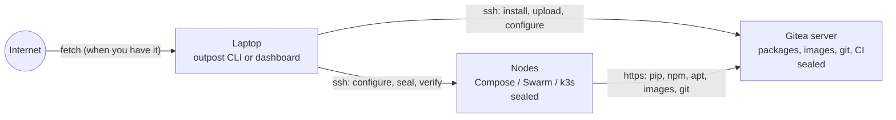

# Outpost documentation

Outpost runs Gitea, Docker, Swarm or k3s on servers that never touch the internet. You run it on
your laptop; the servers only need SSH. These pages explain what it does, how it does it, and why.

## Where to start

| You want to | Read |
|---|---|
| see it work in 20 minutes, with no servers | the [tutorial](tutorial/01-the-problem.md), which builds a lab in Docker and goes all the way to a deployed app |
| understand the design before trusting it | [architecture](architecture/overview.md), especially [the seal](architecture/egress.md) and [what it proves](architecture/security.md) |
| look something up | the [reference](reference/cli.md): commands, `servers.yml`, needs files, Dockerfiles, checks, the platform folder, [day-two commands](reference/maintenance.md) |
| run it without typing commands | [the dashboard](reference/dashboard.md): a Home page with three questions, a Machines page, and one page per step that says what each button will do |
| change or test the code | [development](development/development.md), [testing](development/testing.md), and [decisions](development/decisions.md), which records what we tried and what we learned |

## The tutorial, in order

1. [The problem and the idea](tutorial/01-the-problem.md)
2. [Install Outpost](tutorial/02-install.md)
3. [Build a lab: servers in Docker](tutorial/03-lab.md)
4. [Needs and the box](tutorial/04-needs-and-fetch.md)
5. [Install Gitea](tutorial/05-gitea.md)
6. [Upload the box](tutorial/06-upload.md)
7. [Set up the nodes](tutorial/07-nodes.md)
8. [Prove it](tutorial/08-prove.md)
9. [Deploy a real project](tutorial/09-deploy.md)
10. [Day two, and real servers](tutorial/10-day-two.md)

## Architecture

- [Overview](architecture/overview.md): the pieces, the data flow, the trust boundaries
- [The box](architecture/box.md): what is downloaded, how it is stored, signed and moved
- [Gitea](architecture/gitea.md): how it is installed and why it can replace five services
- [Nodes](architecture/nodes.md): every file and service a node gets, per infrastructure type
- [The seal](architecture/egress.md): the firewall, the two tables, the holes we found
- [CI on sealed nodes](architecture/ci.md): the runners and the demo workflow
- [What it proves](architecture/security.md): the guarantees, and what is out of scope

## Reference

[CLI](reference/cli.md) · [servers.yml](reference/servers.md) · [needs](reference/needs.md) · [Dockerfiles](reference/dockerfiles.md) · [checks](reference/checks.md) · [the platform folder](reference/platform-folder.md) · [the dashboard](reference/dashboard.md) · [day two: backup, updates, rotation, evidence](reference/maintenance.md) · [mirrors and releases](reference/distribution.md) · [limits](reference/limits.md)
