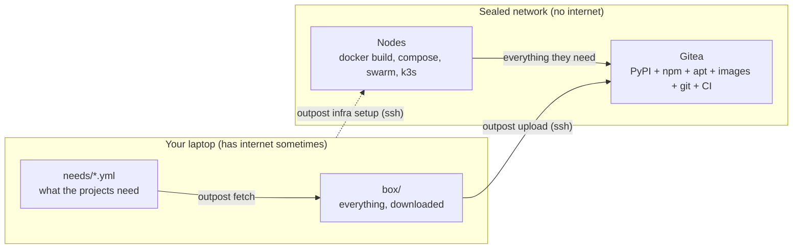

# 1. The problem and the idea

## The hidden dependency

Every build you run reaches out. `pip install` talks to pypi.org, `npm install` to
registry.npmjs.org, `apt-get` to deb.debian.org, `FROM python:3.12` to Docker Hub, and a dozen
tools download "just one file" from GitHub on first use. None of it is written down anywhere.
It works until the day the network is blocked, the registry is down, a package is pulled, or a
compromised package is published, and then nothing ships.

An **air-gapped** system is the strict answer: servers that cannot reach the internet at all.
It is the norm in regulated and isolated environments, and a good discipline anywhere, because
it forces the question *what does this system actually need?* to have a written answer.

The usual way to get there is heavy: a mirror of PyPI, a mirror of npm, an apt mirror, a
container registry, a git server, a CI system, each with its own install, storage and upgrade
path. Outpost's claim is that one small tool and one server are enough.

## The idea, in one picture

Three roles:

- **The laptop** is the control machine. It is the only place that ever has internet. It reads
  your lockfiles, downloads what they list into a folder called the *box*, and talks to the
  servers over plain SSH. Nothing is installed on it except Outpost itself.
- **Gitea** is one static binary on one server. Besides git hosting it ships package registries
  for PyPI, npm, Debian, container images and generic files, and a CI system (Gitea Actions).
  So it stands in for pypi.org, npmjs.org, deb.debian.org, Docker Hub and GitHub at once. Outpost
  calls it *the local internet*.
- **Nodes** are the servers that build and run your software, as Docker Compose hosts, a Docker
  Swarm, or a k3s cluster. Outpost points every package client on them at Gitea and then
  installs a firewall rule that rejects everything else, so a build that still depends on the
  internet fails instantly, with the name of the host it tried.

## What "proof" means here

Outpost does not ask you to believe that a node is offline. After setup it runs `verify`, which
checks each fact over SSH and prints a table: Gitea is reachable over trusted TLS, pip and npm
and apt point only at Gitea, the public internet is rejected, the rule survives a reboot, routed
traffic from containers and pods is sealed too. The smoke checks then build an image on the
node and show a container cannot reach pypi.org. The demo project goes one step further: the
Dockerfile refuses to build if the internet answers, and the page it serves measures the
internet on every request. The [security page](../architecture/security.md) lists exactly what
is and is not guaranteed.

## What you will do in this tutorial

You will build a small lab of four "servers" as Docker containers on your own machine, install
Gitea on one, seal the other three as a Compose node, a two-node Swarm and a k3s server, and
deploy a Flask application to all three through Gitea Actions, with the internet switched off
for every step that happens on a server. The same commands, with real SSH aliases in
`servers.yml`, do the same to real servers; the last chapter covers that.

Next: [Install Outpost](02-install.md)
