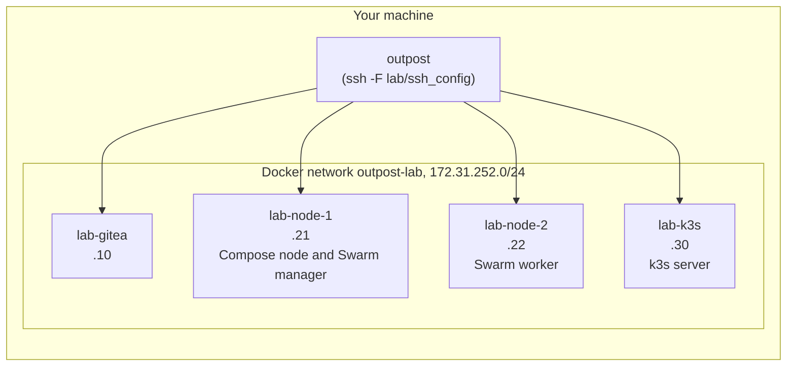

# 3. Build a lab: servers in Docker

You do not need to rent servers to follow this tutorial. `outpost lab up` creates a few
throwaway ones as Docker containers on your machine. They run systemd and sshd and believe
they are machines, so every later command treats them exactly like real servers: over SSH,
from the outside. This is also what the integration tests use, so what passes there is what
you see here.

```
outpost lab up            # add --small to skip the k3s server (saves about 1 GB of RAM)
```

Takes a minute the first time (it builds an image), seconds afterwards.

## What you get



| alias | address | role in `servers.yml` |
|---|---|---|
| lab-gitea | 172.31.252.10 | `gitea.host`, reachable as `gitea.lab` |
| lab-node-1 | 172.31.252.21 | infrastructure `dev` (compose) and manager of `prod` (swarm) |
| lab-node-2 | 172.31.252.22 | worker of `prod` |
| lab-k3s | 172.31.252.30 | infrastructure `k8s` (k3s) |

`lab up` writes `servers.yml` for these and `lab/ssh_config` with one entry per alias, and
points `servers.yml` at that file (`ssh_config: lab/ssh_config`), so your own `~/.ssh/config`
is never touched. One node hosting two infrastructures is deliberate: it shows that an
infrastructure is a role, not a machine.

## How a container becomes a "server"

This is the part worth understanding, because it is the trick that makes the whole lab honest.

1. **The image.** `outpost/templates/lab/Dockerfile` is Ubuntu 24.04 plus `systemd`,
   `openssh-server`, `iptables`, `curl`, `git` and nothing else. Its command is `/sbin/init`,
   so systemd is PID 1 inside the container, exactly as on a VPS. An SSH key is generated into
   `lab/id_ed25519` and its public half is baked in as root's `authorized_keys`.
2. **Privileges.** Each container runs with `--privileged`, `--cgroupns=host` and the host's
   cgroup filesystem mounted, plus tmpfs on `/run`, `/run/lock` and `/tmp`. That is what systemd
   needs to manage services, what Docker needs to run inside a container, and what iptables
   needs to program the container's own network namespace. The firewall seal you will see later
   is real iptables, inside each container.
3. **Storage.** `lab-node-1` and `lab-node-2` get a Docker volume at `/var/lib/docker`,
   `lab-k3s` one at `/var/lib/rancher`, because Docker-in-Docker and containerd want a real
   filesystem for their layers, not the container's overlay.
4. **Network.** A user-defined bridge with a fixed subnet, so the addresses above are stable
   and the Gitea certificate can carry the IP as a subject alternative name.
5. **Readiness.** `lab up` waits until each container answers `ssh ... true`, up to a minute,
   then prints how to get a shell.

It also deletes `state/*.json`, `secrets/gitea-token` and `secrets/gitea-admin-password`,
since those described the previous servers. The CA in `pki/` is kept, so certificates stay valid
across lab rebuilds.

## Look around

```
ssh -F lab/ssh_config lab-node-1
systemctl status ssh            # a real systemd
curl -sS --max-time 3 https://pypi.org    # still works: nothing is sealed yet
exit
```

Keep this habit; after every later step, log in and see what changed on the server.

## What is and is not real

Real: systemd, sshd, iptables, Docker, Swarm, k3s, every file and service Outpost installs, and
the firewall seal. Not real: there is no provider firewall in front of these servers, the
network between them is a Docker bridge with no public addresses, and all of them share your
kernel. Nothing Outpost does depends on those differences.

The lab needs Docker, roughly 3 GB of disk for the servers plus your box, and about 1 GB of RAM
for k3s. `outpost lab down` removes the containers, the network and the volumes; `servers.yml`
and `lab/` stay, so `up` is quick next time.

Next: [Needs and the box](04-needs-and-fetch.md)
