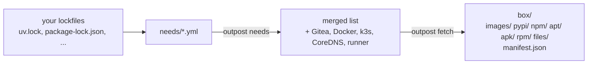

# 4. Needs and the box

Before a server can live without the internet, someone has to write down what it needs. In
Outpost that list is `needs/*.yml`, one file per project, and the answer to the list is the
*box*: a folder of downloaded files with a manifest.



## The needs file

`outpost init` shipped `needs/demo.yml`, which describes the demo project in `demo/`:

```yaml
name: demo
python: "3.12"
images: [python:3.12-slim, alpine:3.20]
pypi:
  - file: ../demo/requirements.txt       # flask and gunicorn, pinned
apt:
  distro: bookworm                       # python:3.12-slim is Debian bookworm
  packages: [curl]
apk:
  branch: v3.20                          # alpine:3.20, for the hello-alpine smoke check
  packages: [curl]
```

Each key is one *kind*: container `images`, `pypi` packages, `npm` packages, OS packages per
distro (`apt` for Debian and Ubuntu, `apk` for Alpine, `rpm` for Rocky, Alma, Fedora and CentOS
Stream), and plain `files` with a URL. For pypi and npm you point at lockfiles you already have
(`requirements*.txt`, `poetry.lock`, `uv.lock`, `Pipfile.lock`, `package-lock.json`,
`pnpm-lock.yaml`, `yarn.lock`); Outpost reads the exact versions from them. The
[needs reference](../reference/needs.md) covers every form.

The dashboard can write this file for you: point it at a project folder and it reads the
lockfiles, the `FROM` lines and `apt-get install`, `apk add` and `dnf install` lines of the
Dockerfiles, and the Python version, then proposes a needs file to review.

## What Outpost adds on its own

```
outpost needs
```

prints the merged list. Besides your entries you will see *pinned downloads*: Gitea itself,
CoreDNS, the Gitea Actions runner, and Docker with its Compose and buildx plugins or k3s with
its air-gap image bundle, depending on the infrastructure types in `servers.yml`. Their versions
are pinned in `outpost/versions.py`. These are the only things Outpost needs that you did not
list, and they go through the same box and the same registries as your own files.

## Fetch

```
outpost fetch                 # or: outpost fetch --only pypi images
```

How each kind is downloaded, and what it needs on the laptop:

| kind | how | needs |
|---|---|---|
| images | pulled over plain HTTP from the registry into an OCI layout folder, the linux/amd64 variant of each image; no Docker involved | nothing |
| pypi | `pip download` with `--only-binary` for the Python version in the needs file and Linux wheel tags; sdist as a fallback | pip |
| npm | the exact tarball URL from the lockfile, or the registry's metadata for a `name@version` | nothing |
| apt | inside a `debian:<distro>` or `ubuntu:<distro>` container: `apt-cache depends` for the full tree, then `apt-get download`, so the packages install on a slim image, a full image or a host alike | Docker |
| apk | inside an `alpine:<version>` container of the branch: `apk fetch --recursive`, the full tree | Docker |
| rpm | inside a `rockylinux:9`, `almalinux:9`, `fedora:40` or `quay.io/centos/centos:stream9` container: `dnf download --resolve --alldeps`, the full tree | Docker |
| files | a plain download into `files/<name>/<version>/<filename>` | nothing |

Fetch is incremental: whatever is already in the box is skipped, so re-running it after adding
one package downloads one package. Failures are collected and printed at the end rather than
aborting the run. The result is recorded in `state/fetch.json`.

## Look at the box

```
ls box/
cat box/manifest.json | head -20
```

The manifest lists every file with its size and SHA-256. `upload` checks the box against it
before sending anything, and `outpost pack` turns the box into one `tar.xz` per kind plus a
signed manifest, for moving it by USB stick or publishing it as a GitHub release. The
[box page](../architecture/box.md) explains the layout, the OCI folders and the signing.

## Where things are blocked

If your laptop sits behind a blocked network, `mirrors.yml` changes where fetch downloads from,
for each registry, while uploads to Gitea keep the normal names. See
[mirrors and releases](../reference/distribution.md).

Next: [Install Gitea](05-gitea.md)
