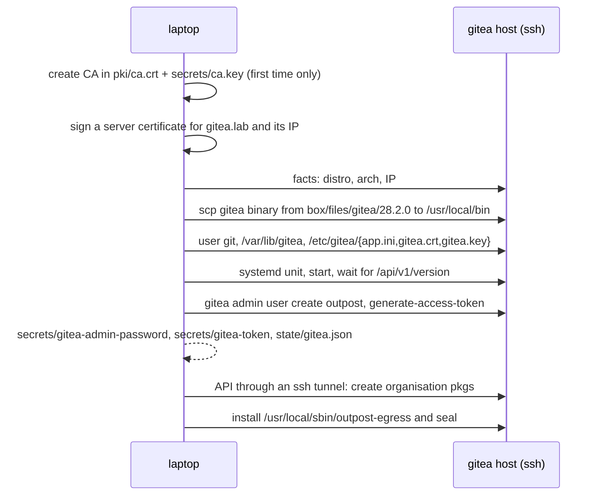

# 5. Install Gitea

```
outpost gitea setup
```

This is the first command that touches a server. It runs for about half a minute against the
lab and prints one line per step. At the end `lab-gitea` runs Gitea on HTTPS port 443, with its
outbound internet sealed.

## What happens, step by step



In words:

1. **Certificates.** Outpost creates a private certificate authority on your laptop, once, with
   the `openssl` command line: `pki/ca.crt` (public, commit it) and `secrets/ca.key` (never
   commit). It then signs a server certificate for the Gitea name from `servers.yml` plus the
   server's IP. Every node will trust this CA, which is why pip, npm, apt and Docker can use
   HTTPS to Gitea without any `--insecure` flags anywhere.
2. **The binary.** Gitea is a single static file. It is copied from the box with `scp`, not
   downloaded by the server. The server never needs internet for this.
3. **Configuration.** `/etc/gitea/app.ini` is written once and kept afterwards (edit it and
   restart Gitea if you want to change something). The choices: HTTPS on 443 with the
   certificate above; SQLite, so there is no database server; packages enabled with no size
   limits; Actions enabled; registration disabled; `OFFLINE_MODE` so Gitea serves its own
   assets rather than linking to CDNs; a built-in SSH server on port 2222 for git pushes.
4. **Service.** A systemd unit runs Gitea as the unprivileged user `git` with only the
   capability to bind port 443. Outpost waits until the API answers.
5. **Admin user and token.** `gitea admin user create` makes the `outpost` user with a random
   password, stored in `secrets/gitea-admin-password` so you can log in to the web UI. An API
   token with full scope is generated for Outpost's own use and stored in `secrets/gitea-token`.
   If a later run finds that this Gitea does not accept the stored token, because the server
   was reinstalled or the lab recreated, it makes a new one.
6. **The organisation.** Through the API, Outpost creates the organisation `pkgs` (the `org`
   in `servers.yml`), which will own the pip, npm, apt and file packages.
7. **The seal.** Finally the egress script is installed and run: from now on this server
   rejects every outbound connection except replies, DNS, private networks and what you list
   under `allow`. The server was sealed *after* everything it needed arrived from the box, and
   nothing it needs later comes from anywhere but the box.

Running the command again is safe and fast: every step checks before acting.

## How the laptop talks to Gitea

The laptop never assumes it can resolve `gitea.lab` or route to port 443. SSH already works, so
the API rides on it: Outpost opens an SSH tunnel to the Gitea host's port 443, sends requests
to `localhost` with the `Host` header set to the Gitea name, and verifies the certificate
against `pki/ca.crt`. The same tunnel carries the uploads in the next chapter.

## Look around

```
outpost gitea info
ssh -F lab/ssh_config lab-gitea
systemctl status gitea
outpost-egress status                       # sealed
curl -sS --max-time 3 https://pypi.org      # rejected at once
cat /var/log/outpost-egress.log             # who sealed or opened, when, why
exit
```

The web UI is at `https://172.31.252.10`. Your browser will warn about the private CA unless
you import `pki/ca.crt`. Log in as `outpost` with the password in `secrets/gitea-admin-password`.
The [Gitea page](../architecture/gitea.md) explains the registries and the token model.

Next: [Upload the box](06-upload.md)
