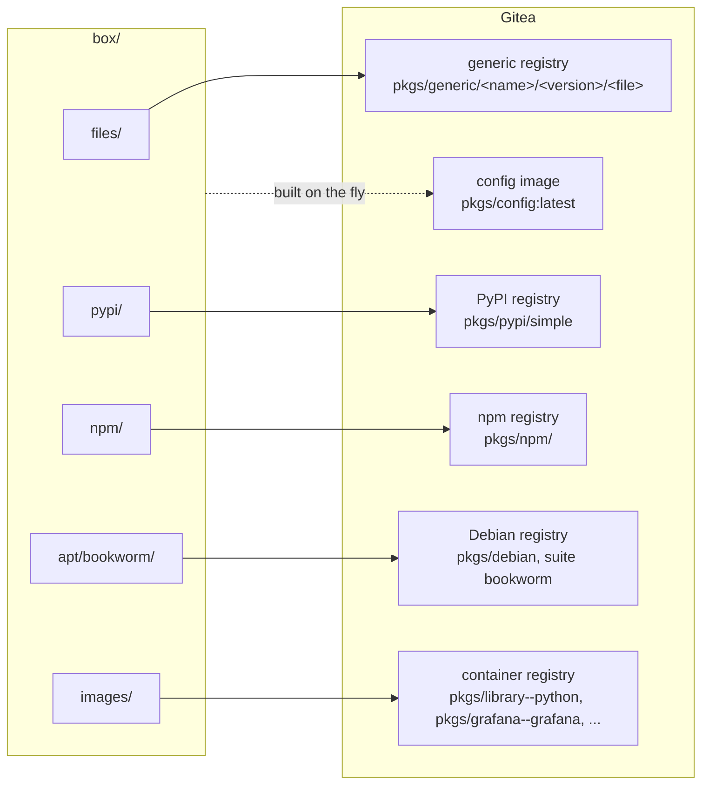

# 6. Upload the box

```
outpost upload                # or: outpost upload dist/*.tar.xz
```

Everything in the box goes into Gitea's package registries, through the same SSH tunnel as
before. The lab box is about 650 MB and takes a minute or two.

## Where each kind lands



| kind | Gitea registry | URL a client uses |
|---|---|---|
| files | generic | `https://gitea.lab/api/packages/pkgs/generic/<name>/<version>/<filename>` |
| pypi | PyPI | `https://gitea.lab/api/packages/pkgs/pypi/simple` |
| npm | npm | `https://gitea.lab/api/packages/pkgs/npm/` |
| apt | Debian, one suite per distro | `deb https://gitea.lab/api/packages/pkgs/debian bookworm main` |
| apk | Alpine, one branch per branch | `https://gitea.lab/api/packages/pkgs/alpine/v3.20/main` in `/etc/apk/repositories` |
| rpm | RPM, one group per distro | `baseurl=https://gitea.lab/api/packages/pkgs/rpm/rocky9` in `outpost.repo` |
| images | container | `gitea.lab/pkgs/library--python:3.12-slim` |

Images move under `pkgs` like everything else, with their original owner kept inside the
name: `python:3.12-slim` becomes `pkgs/library--python:3.12-slim`, `grafana/grafana:10.2`
becomes `pkgs/grafana--grafana:10.2`, `ghcr.io/org/app:1.4` becomes `pkgs/org--app:1.4`. The
owner stays so that `library/redis` and `bitnami/redis` cannot collide. Dockerfiles and
manifests then name that copy explicitly, `FROM gitea.lab/pkgs/library--python:3.12-slim`;
nothing on a node rewrites a Docker Hub name, and a bare `FROM python:3.12-slim` fails at once
on a sealed node, which is the honest answer. The upload log prints every mapping:

```
==> images
    python:3.12-slim  ->  gitea.lab/pkgs/library--python:3.12-slim
    alpine:3.20       ->  gitea.lab/pkgs/library--alpine:3.20
```

Before sending anything, upload verifies every file against `manifest.json`. Gitea answers
409 for a file it already has, so re-uploading a box costs one request per file and no
transfer. Images are pushed blob by blob the way `docker push` does it: HEAD each blob, upload
only the missing ones, then PUT the manifest.

## The config image

The last thing upload does is build and push a tiny image, `pkgs/config:latest`, from the same
client configuration files every node will get:

```
/etc/outpost/ca.crt                       the CA
/etc/outpost/gitea-apt.asc                Gitea's apt signing key
/etc/pip.conf                             index-url = https://gitea.lab/api/packages/pkgs/pypi/simple
/etc/npmrc, /usr/local/etc/npmrc          registry  = https://gitea.lab/api/packages/pkgs/npm/
/etc/apt/sources.list.d/outpost.list      deb [signed-by=...] https://gitea.lab/api/packages/pkgs/debian bookworm main
/etc/apt/apt.conf.d/99outpost             Acquire::https::CaInfo "/etc/outpost/ca.crt"
/etc/apt/sources.list, debian.sources     emptied, so apt cannot even try the internet
/etc/apk/repositories                     https://gitea.lab/api/packages/pkgs/alpine/v3.20/main (or emptied when Gitea has no Alpine branch)
/etc/apk/keys/pkgs@<fingerprint>.rsa.pub  Gitea's Alpine signing key, under the name apk looks for
/etc/yum.repos.d/outpost.repo             [outpost-rocky9] baseurl=https://gitea.lab/api/packages/pkgs/rpm/rocky9, gpgkey, sslcacert
/etc/outpost/gitea-rpm.asc                Gitea's RPM signing key
/etc/yum.repos.d/rocky.repo, fedora.repo, almalinux-*.repo, centos*.repo   overwritten with a comment: no public mirror reachable
```

A Dockerfile copies it in with one line, `COPY --from=config / /`, and every later `RUN
apt-get`, `pip install` or `npm install` in that build finds Gitea by itself. The image is
built in memory on the laptop (Outpost has its own small OCI implementation, no Docker needed)
and only includes apt lines, apk lines, rpm sections and their keys for distros and branches
that actually exist in Gitea. It holds text files only, so it copies cleanly onto any base image.

`state/upload.json` records what went in; the dashboard uses it to warn when the box changed
after the last upload.

## Look around

Open `https://172.31.252.10/pkgs/-/packages` in a browser: every package, with its files.
Or from the Gitea host, which is allowed to reach itself:

```
ssh -F lab/ssh_config lab-gitea
curl -sk https://gitea.lab/api/packages/pkgs/pypi/simple/flask/
curl -sk https://gitea.lab/v2/pkgs/library--python/tags/list
exit
```

Next: [Set up the nodes](07-nodes.md)
