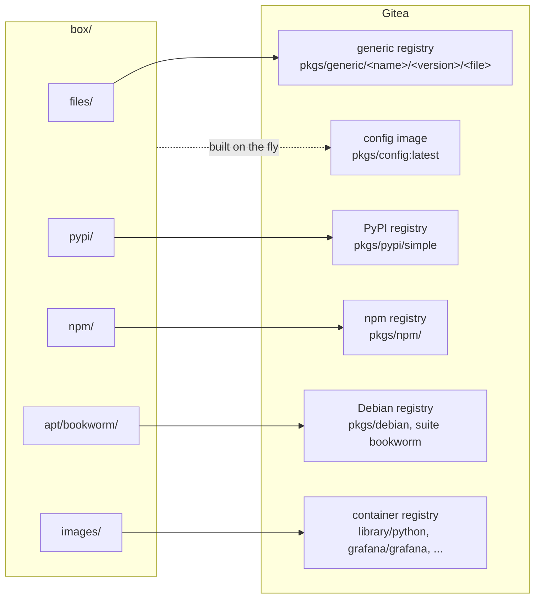

# 6. Upload the box

```
outpost upload                # or: outpost upload dist/*.tar.xz
```

Everything in the box goes into Gitea's package registries, through the same SSH tunnel as
before. The lab box is about 650 MB and takes a minute or two.

## Where each kind lands



| kind | Gitea registry | URL a client uses |
|---|---|---|
| files | generic | `https://gitea.lab/api/packages/pkgs/generic/<name>/<version>/<filename>` |
| pypi | PyPI | `https://gitea.lab/api/packages/pkgs/pypi/simple` |
| npm | npm | `https://gitea.lab/api/packages/pkgs/npm/` |
| apt | Debian, one suite per distro | `deb https://gitea.lab/api/packages/pkgs/debian bookworm main` |
| images | container | `gitea.lab/library/python:3.12-slim` |

Images keep their original namespace rather than moving under `pkgs`: `python:3.12-slim`
becomes `library/python:3.12-slim`, `grafana/grafana` stays `grafana/grafana`. That is what
lets a Docker daemon use Gitea as a transparent *mirror* for Docker Hub names, so `FROM
python:3.12-slim` in a Dockerfile works unchanged.

Before sending anything, upload verifies every file against `manifest.json`. Gitea answers
409 for a file it already has, so re-uploading a box costs one request per file and no
transfer. Images are pushed blob by blob the way `docker push` does it: HEAD each blob, upload
only the missing ones, then PUT the manifest.

## The config image

The last thing upload does is build and push a tiny image, `pkgs/config:latest`, from the same
client configuration files every node will get:

```
/etc/outpost/ca.crt                       the CA
/etc/outpost/gitea-apt.asc                Gitea's apt signing key
/etc/pip.conf                             index-url = https://gitea.lab/api/packages/pkgs/pypi/simple
/etc/npmrc, /usr/local/etc/npmrc          registry  = https://gitea.lab/api/packages/pkgs/npm/
/etc/apt/sources.list.d/outpost.list      deb [signed-by=...] https://gitea.lab/api/packages/pkgs/debian bookworm main
/etc/apt/apt.conf.d/99outpost             Acquire::https::CaInfo "/etc/outpost/ca.crt"
/etc/apt/sources.list, debian.sources     emptied, so apt cannot even try the internet
```

A Dockerfile copies it in with one line, `COPY --from=config / /`, and every later `RUN
apt-get`, `pip install` or `npm install` in that build finds Gitea by itself. The image is
built in memory on the laptop (Outpost has its own small OCI implementation, no Docker needed)
and only includes apt lines for distros that actually exist in Gitea.

`state/upload.json` records what went in; the dashboard uses it to warn when the box changed
after the last upload.

## Look around

Open `https://172.31.252.10/pkgs/-/packages` in a browser: every package, with its files.
Or from the Gitea host, which is allowed to reach itself:

```
ssh -F lab/ssh_config lab-gitea
curl -sk https://gitea.lab/api/packages/pkgs/pypi/simple/flask/
curl -sk https://gitea.lab/v2/library/python/tags/list
exit
```

Next: [Set up the nodes](07-nodes.md)
