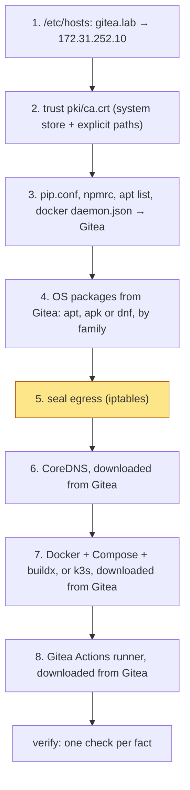
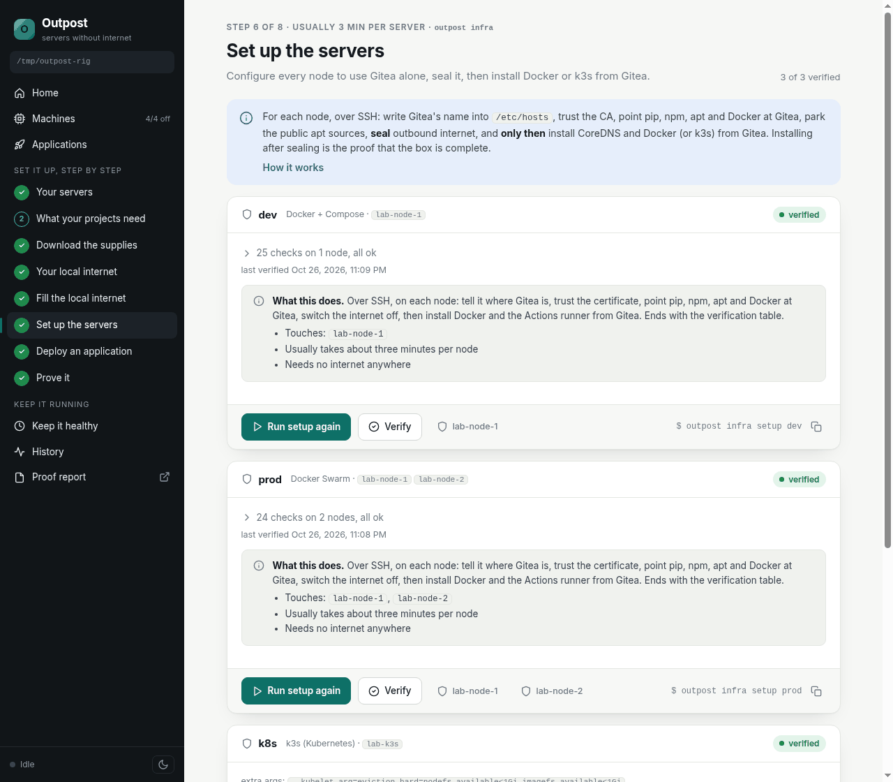

# 7. Set up the nodes

```
outpost infra setup dev        # one Compose node
outpost infra setup prod       # a two-node Swarm
outpost infra setup k8s        # a k3s server
```

Each command configures the nodes of one infrastructure from `servers.yml`, seals them,
installs the runtime, and ends with a verification table in which every line should say
`ok`. Run the three in turn; `dev` takes about a minute on the lab, `k8s` about two.

## The order of steps is the point



Everything after step 5 runs with the internet already blocked. Docker, k3s, CoreDNS and the
runner are fetched with `curl --cacert /etc/outpost/ca.crt` from Gitea's generic registry. If
setup finishes, the node provably needed nothing from outside, and that is not an argument,
it is what just happened.

What each step does on the server:

1. **Name.** The Gitea name and IP go into `/etc/hosts`. No DNS server is needed anywhere.
2. **Trust.** The CA is copied to `/etc/outpost/ca.crt`, into the system trust store, into
   Docker's `certs.d/gitea.lab/` and referenced by pip, npm and apt explicitly, so every client
   trusts Gitea's certificate whichever store it reads. Setup then checks that the node can
   reach `https://gitea.lab/api/v1/version` and stops with a clear message if it cannot.
3. **Clients.** The same files that went into the config image are written on the host, plus
   `/etc/docker/daemon.json` with the node's own DNS server (no registry mirror: images are
   named by their Gitea copy, and Docker trusts it through `certs.d`), and
   `/etc/profile.d/outpost.sh` with `PIP_INDEX_URL` and friends for interactive shells.
4. **OS packages.** On Debian and Ubuntu, Gitea's apt signing key is fetched, the stock sources
   are moved to `/etc/apt/sources.disabled/`, and `outpost.list` is written with one line per
   distro Gitea actually serves (the node's own codename is tried too, in case you uploaded
   packages for it). An Alpine node gets the same treatment for apk (`/etc/apk/repositories`
   parked as `repositories.disabled`, Gitea's key under `/etc/apk/keys/`), a Rocky, Alma, Fedora
   or CentOS Stream node for dnf (`*.repo` files parked in `/etc/yum.repos.d.disabled/`,
   `outpost.repo` written). The family comes from `/etc/os-release`.
5. **Seal.** `/usr/local/sbin/outpost-egress` is installed with a systemd unit that re-applies
   it at boot, and run. From now on: loopback, replies, DNS, Gitea, private networks and the
   `allow` list are reachable; nothing else is. [The seal](../architecture/egress.md) has the details.
6. **DNS for containers.** Containers do not see the host's `/etc/hosts`, and pip refuses to
   use HTTPS against a bare IP. So every node runs CoreDNS, a single static binary, bound to the node's
   IP, with a six-line config: answer from `/etc/hosts`, forward everything else to the host's
   resolvers. Docker's `daemon.json` hands that server to every container and build; k3s hands
   it to every pod through `--resolv-conf`.
7. **Runtime.** For `compose` and `swarm`: Docker's static binaries, a systemd unit ordered
   after the egress unit, the Compose and buildx CLI plugins. The first Swarm node runs
   `docker swarm init`, the others join as workers with the token. For `k3s`: `registries.yaml`
   that gives containerd the CA for Gitea, the k3s air-gap image bundle placed where k3s looks, and
   the official installer run with `INSTALL_K3S_SKIP_DOWNLOAD=true`; agents join the server
   with its node token.
8. **Runner.** The official Gitea Actions runner is installed on the first node of each
   infrastructure, in host mode, labelled with the infrastructure's name. Chapter 9 uses it.

The [nodes page](../architecture/nodes.md) lists every file and unit by path.

## Several nodes, several infrastructures

When an infrastructure has more than one node, each node's IP is added to every other node's
allow list, so Swarm and k3s can talk across public addresses on real servers. One node may
belong to several infrastructures: in the lab, `lab-node-1` is the `dev` Compose node and the
`prod` Swarm manager, and its runner carries both labels.

## Verify

Setup ends with `verify`, and you can run it alone at any time:

```
outpost infra verify dev
```

Each line is one shell command on the node that must succeed. The common ones:

```
ok   gitea in /etc/hosts
ok   gitea reachable with trusted TLS
ok   system trust store has the CA
ok   pip points at gitea
ok   npm points at gitea
ok   package sources are gitea only
ok   node dns for containers running
ok   package index updates offline
ok   egress sealed
ok   public internet rejected
ok   egress seal survives reboot
ok   routed traffic sealed too (containers, pods)
```

plus per type: Docker running and trusting Gitea's registry, container egress hooked, swarm
active, k3s active with `registries.yaml` pointing at Gitea, actions runner active. The result
goes to `state/verify-<name>.json`; the dashboard shows it per node.



## Look around

```
ssh -F lab/ssh_config lab-node-1
cat /etc/pip.conf /etc/docker/daemon.json /etc/apt/sources.list.d/outpost.list
iptables -S OUTPOST                           # the chain
docker pull gitea.lab/pkgs/library/alpine:3.20     # works: the Gitea copy of alpine:3.20
docker pull alpine:3.20                             # fails at once: Docker Hub is rejected, nothing rewrites the name
docker run --rm gitea.lab/pkgs/library/alpine:3.20 wget -T 3 https://pypi.org   # fails at once
exit
```

Next: [Prove it](08-prove.md)
