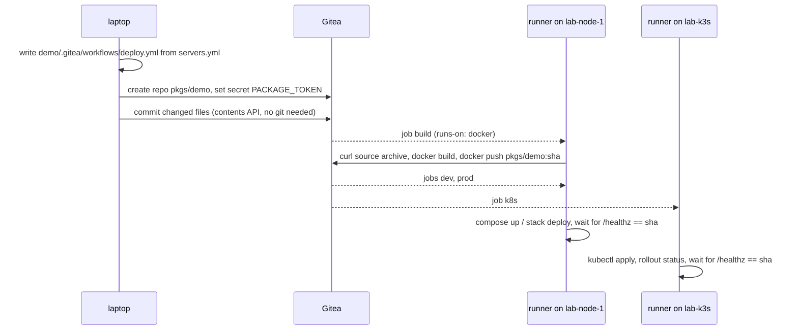

# 9. Deploy a real project

Nodes that *can* work offline are one thing. This chapter ships an application through them
the way a team would: push to git, a workflow builds and deploys, open the browser. Every step
runs on the sealed nodes, and the page that comes up measures the internet itself.

```
outpost demo push
outpost demo status
```

Then open, for the lab:

| infrastructure | URL | deployed with |
|---|---|---|
| dev (compose) | http://172.31.252.21:8000 | `docker compose up` |
| prod (swarm) | http://172.31.252.21:8080, also on .22 | `docker stack deploy`, two replicas |
| k8s (k3s) | http://172.31.252.30:30080 | `kubectl apply`, a NodePort service |
| the pipeline | https://172.31.252.10/pkgs/demo/actions | Gitea Actions |


## The project

`demo/` in your platform folder is a small Flask site served by gunicorn, with a Dockerfile
whose first five lines are the only Outpost-specific thing in it: the config stage, and the
base image named by its Gitea copy.

```dockerfile
ARG GITEA=gitea.internal
ARG ORG=pkgs
FROM ${GITEA}/${ORG}/config:latest AS config
FROM ${GITEA}/${ORG}/library/python:3.12-slim
COPY --from=config / /
RUN apt-get update && apt-get install -y --no-install-recommends curl
COPY requirements.txt .
RUN pip install --no-cache-dir -r requirements.txt
...
RUN python probe.py --write build-proof.json --fail-if-reachable
```

The last `RUN` tries to connect to pypi.org, registry.npmjs.org, deb.debian.org, Docker Hub and
1.1.1.1 from inside the build container and exits 1 if anything answers. An image can only
exist if that step passed, and its measurements are baked in as `build-proof.json`. The page
repeats the measurement on every request and shows both.

`compose.yml`, `stack.yml` and `k8s.yml` are ordinary deploy files for the three runtimes;
`needs/demo.yml` lists what the Dockerfile needs, so it was fetched and uploaded in earlier chapters.

## What `demo push` does



1. Writes the workflow from `servers.yml`: one `build` job and one deploy job per
   infrastructure that has been set up. Edit `servers.yml`, push again, and it is regenerated.
2. Creates the `pkgs/demo` repository and gives it one Actions secret, `PACKAGE_TOKEN`, a
   token that may only write packages. Gitea's automatic job token can read the repository but
   cannot log into the container registry, so this one is made once with the admin password
   and kept in `secrets/gitea-package-token`.
3. Commits every changed file through Gitea's API, so you do not need git on the laptop.
   Unchanged files are not committed; a second push with no edits does nothing.
4. The commit triggers the workflow. `demo status` shows the runs, the jobs and what each node
   serves: the commit, and whether it was sealed at build time and is sealed now.

## The runners

Chapter 7 installed the official Gitea runner on the first node of each infrastructure, in
**host mode**: a job is a shell script run on the node itself, not in a job container. That is
what keeps the pipeline honest. There is no runner image to mirror, no `actions/checkout` to
vendor, and the job is under the node's seal like everything else. The runner's labels are the
infrastructure names the node leads, plus `docker` when it has Docker; `runs-on: dev` means
"on the dev node". [CI on sealed nodes](../architecture/ci.md) has the workflow in full.

## Why you can be certain

Three independent measurements, none taken on trust:

- **At build time.** The Dockerfile's probe refuses to produce an image if the internet
  answers. The result is stored in the image.
- **At run time.** Each page load probes again from inside the running container, on the node
  it was deployed to. *rejected* means the firewall refused; *timeout* or *unresolvable* means
  there was no path at all. Gitea is probed too and shows green.
- **From outside.** `infra verify` and `egress status` check the node over SSH, and the egress
  log records every time anyone opened the internet.

The negative test: add a package to `demo/requirements.txt` without fetching it, push, and
watch the build fail within a second with pip naming Gitea's index. Fetch, upload, push: green.

## Your own project

Copy the first three lines of the Dockerfile, add your lockfile to a needs file, fetch, upload,
create a repository in Gitea, push your code (git over HTTPS to `https://<gitea ip>/pkgs/<repo>.git`
as `outpost`, or SSH on port 2222), and take `deploy.yml` as it is: the `runs-on` names are
your infrastructures.

Next: [Day two, and real servers](10-day-two.md)
