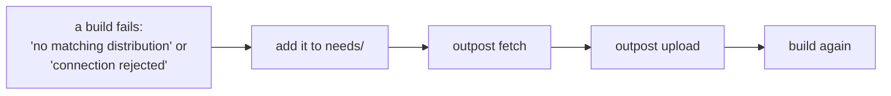

# 10. Day two, and real servers

## The daily loop



- **A project needs a new package.** Add it to its needs file (or just update the lockfile the
  needs file points at), `outpost fetch`, `outpost upload`. Both are incremental.
- **Something reaches for the internet.** It fails within a second, naming the host or the
  package. That message is the to-do item.
- **A new project.** One needs file, one Dockerfile change, one repository in Gitea.
- **A moment of internet on a server.** `outpost egress <target> open --reason "..."`, then
  `seal`. Every flip is in the server's log.
- **Bumping Docker, k3s, Gitea or CoreDNS.** Comes with a new Outpost release: fetch, upload,
  `gitea setup` (which backs Gitea up first), `infra setup` again; each step only acts where
  something changed, and `outpost hosts` shows what is at which version.
- **New nodes.** Add them to `servers.yml`, run `infra setup <name>` again.
- **A backup.** `outpost gitea backup` after each upload; the archive lands in `backups/`.
  `outpost gitea restore <archive>` puts it back.
- **Security updates.** List the packages in `needs/os-updates.yml` (there is an example next
  to it), fetch, upload, `outpost infra upgrade <name>`. The nodes stay sealed throughout.
- **Evidence.** `outpost report` writes one HTML page with every table and date, for whoever
  needs to be convinced.

The [day-two reference](../reference/maintenance.md) has the details of each, and a routine.
The dashboard's Home page answers the three questions (downloaded? on the server? sealed and
working?) and its *Keep it healthy* page has a card for each of these.

## Taking it to real servers

Nothing in the tutorial depended on the lab except the addresses. For real servers:

1. Put the servers in `~/.ssh/config` as aliases, with a user that is root or has passwordless
   sudo, and check `ssh <alias> true` works.
2. `outpost init my-platform`, and in `servers.yml` set `gitea.host` to the Gitea server's
   alias, `gitea.name` to the name nodes will use (any name; it goes into `/etc/hosts`, no DNS
   needed), and the infrastructures to your node aliases. Remove `ssh_config:` if the lab put it there.
3. Open the inbound ports in your provider's firewall: 443 to the Gitea server from the nodes,
   2222 if you want git over SSH, 2377/7946/4789 between Swarm nodes, 6443/8472/10250 between
   k3s nodes. Outpost never touches inbound rules.
4. Fetch, `gitea setup`, `upload`, `infra setup`, `check`, in the same order as the tutorial.
5. Commit the platform folder, without `secrets/` and `box/`. The box can be published as a
   signed GitHub release and fetched on a schedule; see [mirrors and releases](../reference/distribution.md).

Things to know on real servers: Gitea needs `git` installed (Ubuntu server has it, minimal
Debian may not; setup tries the package manager once and otherwise tells you); the Gitea
server's disk holds every package and image, so give it room; `outpost gitea backup` after
every upload, and keep the archive off the laptop. ARM servers work with `arch: arm64` in
`servers.yml`, untested so far. The [limits page](../reference/limits.md) lists what Outpost
does not do.

## Stopping the lab

```
outpost lab down
```

removes the containers, the network and the volumes. `outpost lab up` later gives you fresh
servers; `gitea setup` and `demo push` notice that the new Gitea does not know the stored
tokens and make new ones.

That is the whole tutorial. The [architecture](../architecture/overview.md) pages explain each
part in more depth, and [decisions](../development/decisions.md) records what we tried on the
way and what did not work.
